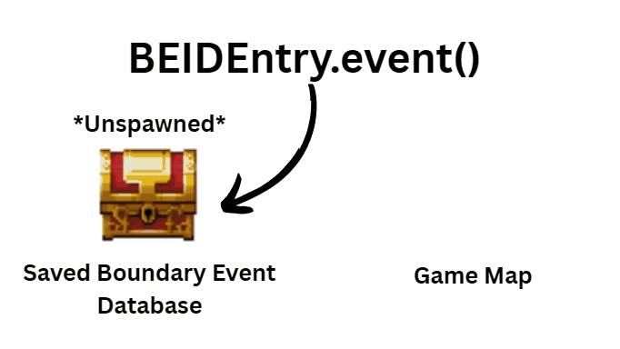

# BEID Database

The **Boundary Event ID (BEID) Database** allows you to identify and manage persistent boundary events, even when they aren't currently spawned on the map.

When a saved boundary event is unspawned and later restored, its regular RPG Maker event ID may change because the Event Spawner recycles available event IDs.

Its **BEID**, however, stays with it.

This allows you to find the same NPC, treasure chest, resource, or other saved event throughout your game, regardless of how many times it has been spawned or unspawned.

The BEID Database is part of the Boundary System. Temporary boundary events and events created through the base Event Spawner do not automatically receive BEIDs.

---

## What Is a BEID?

A **BEID** is a persistent numeric identifier assigned to a saved boundary event.

Each saved event receives a BEID within its owning boundary and gameplay map.

For example, imagine you have an NPC with the following information:

| Property | Value |
|---|---|
| Boundary Name | `NPCs` |
| Gameplay Map ID | `1` |
| BEID | `5` |

Together, these three values identify that specific saved boundary event.

Another boundary or gameplay map could also contain an event with BEID `5`, so the BEID number alone is not necessarily unique across your entire game.

When storing a reference to a saved boundary event, keep its **boundary name, gameplay map ID, and BEID** together.

For example:

```js
const npcRef = {
    boundaryName: "NPCs",
    mapId: 1,
    BEID: 5
};
```

You can use these values later to find the event in the BEID Database.

**Important:** BEIDs are assigned automatically. You don't need to assign them yourself or modify the database's internal identifiers.

If a saved boundary event is permanently deleted, its BEID may eventually be reused. Don't continue using an old reference after deleting its event.

---

## Accessing a BEID Entry

Use the following script call to retrieve an event's entry from the BEID Database:

```js
Ritter.getBEIDEntry(boundaryName, mapId, BEID);
```

### Arguments

| Argument | Description |
|---|---|
| `boundaryName` | The name of the spawn boundary that owns the event. |
| `mapId` | The ID of the gameplay map containing the saved event. |
| `BEID` | The event's persistent Boundary Event ID. |

### Example: Finding a Saved NPC

Imagine you want to find an NPC belonging to the `"NPCs"` boundary on map 1, with BEID `5`.

```js
const boundaryName = "NPCs";
const mapId = 1;
const beid = 5;

const entry = Ritter.getBEIDEntry(boundaryName, mapId, beid);
```

If the saved event exists, `entry` contains its BEID Database entry.

If no matching entry is found, the function returns `null`.

You can check the result before using it:

```js
const entry = Ritter.getBEIDEntry("NPCs", 1, 5);

if (entry) {
    console.log(entry);
}
```

This displays the entry in the developer console, allowing you to inspect its information.


The entry contains information about the saved event, including its template, current status, and last recorded position.

---

## Understanding BEID Entry Properties

Each BEID entry contains information used to identify and manage its saved event.

The following properties may be useful when inspecting an entry:

| Property | Description |
|---|---|
| `BEID` | The event's persistent Boundary Event ID. |
| `boundaryName` | The name of the boundary that owns the event. |
| `mapId` | The gameplay map ID associated with the event. |
| `spawnMap` | The source map containing the event's template. |
| `spawnId` | The event ID of the source template. |
| `spawned` | Whether the database currently records the event as spawned. |
| `spawnedEventId` | The event's current runtime ID, or `null` when it isn't spawned. |
| `lastKnownX` | The event's last recorded X coordinate. |
| `lastKnownY` | The event's last recorded Y coordinate. |
| `event()` | Retrieves the event representation associated with this entry. |

### Important Notes

**Runtime Event IDs Can Change**

The `spawnedEventId` property identifies the event's current runtime ID when it is spawned.

Because the Event Spawner recycles event IDs, this value may change after the event is unspawned and restored.

Use the BEID when you need to maintain a persistent reference.

**Last Known Position**

The `lastKnownX` and `lastKnownY` properties contain the event's last recorded coordinates.

These values are useful for inspecting saved event information, but they should not be treated as live position trackers or movement controls.

Changing these properties directly does not move the event.

**Avoid Editing Database Properties Directly**

The BEID Database manages event identities and their associated information automatically.

You can inspect its entries, but use the provided script calls and RPG Maker event methods when you want to change an event's state or behavior.

---

## Accessing an Event with `event()`

A BEID entry provides an `event()` method that retrieves its associated event representation.

```js
const entry = Ritter.getBEIDEntry("NPCs", 1, 5);

if (entry) {
    const event = entry.event();
}
```

The result depends on whether the saved boundary event is currently spawned, has been unspawned, or is still a preload.

### Understanding the Different Event States

| Event State | What `event()` Returns |
|---|---|
| **Currently Spawned** | The active `Game_Event` object when available. |
| **Previously Spawned, Now Unspawned** | A saved `Game_Event` representation that is no longer active on the map. |
| **Preloaded, Never Spawned** | The preload's stored data object. |
| **Missing or Unavailable** | `null`. |

This distinction is important because **a saved event can exist in the BEID Database without being active on the map**.

### Working with Active Events

When an event is spawned on the current gameplay map, you can use its `Game_Event` methods to interact with it.

For example:

```js
const boundaryName = "NPCs";
const mapId = 1;
const beid = 5;

const entry = Ritter.getBEIDEntry(boundaryName, mapId, beid);

if ($gameMap.mapId() === mapId && entry && entry.spawned) {
    const event = entry.event();

    if (event) {
        event.setOpacity(160);
    }
}
```

This example changes the NPC's opacity to `160`, but only if the database identifies it as spawned on the current map and its event object is available.

### Working with Unspawned Events

An unspawned event may still have a saved `Game_Event` representation, but it isn't actively running on the map.

That means you shouldn't attempt to move it or manipulate its sprite as though it were currently spawned.

You can still work with its saved information using the Boundary System's supported APIs.

### Working with Preloaded Events

A preloaded event hasn't appeared on the map yet.

Its `event()` result is a preload data object rather than a live `Game_Event`.

Preload objects can be identified by their `isPreloadObj` property.

You can inspect their saved information and use their BEIDs, but you cannot call normal `Game_Event` movement or visual methods on them.



**Remember:** An event existing in the BEID Database does not necessarily mean it is currently spawned.

---

## Getting a BEID from a Preloaded Event

When you create a preload using `Ritter.preloadEvent()`, the function returns the newly created preload entry.

That entry contains the event's assigned BEID in its `_BEID` property.

### Example: Preloading an NPC

```js
const boundaryName = "NPCs";
const spawnMapId = 2;
const spawnEventId = 1;
const x = 8;
const y = 10;

const preload = Ritter.preloadEvent(
    boundaryName,
    spawnMapId,
    spawnEventId,
    x,
    y
);

if (preload) {
    const beid = preload._BEID;

    console.log("Preloaded event BEID:", beid);
}
```

This creates a preload on the current gameplay map and retrieves its BEID directly from the returned entry.

You can then use that BEID to retrieve its database entry:

```js
if (preload) {
    const mapId = $gameMap.mapId();
    const beid = preload._BEID;

    const entry = Ritter.getBEIDEntry(
        boundaryName,
        mapId,
        beid
    );
}
```

The preload entry is associated with its persistent BEID Database record through its BEID.

**Tip:** Check that `Ritter.preloadEvent()` successfully returned an entry before accessing `_BEID`.

For more information, see [Preloaded Boundary Events](preloadevents.html).

---

## Managing Persistent Event Data

One of the most useful things you can do with a BEID is access an event's persistent information.

The Boundary System provides [Self Variables](selfvariables.html) for storing custom data that belongs to individual saved events.

For example, imagine an NPC with BEID `5` who needs to remember their quest progress.

You can update that NPC's quest stage using:

```js
const boundaryName = "NPCs";
const mapId = 1;
const beid = 5;

Ritter.setSelfVariable(
    boundaryName,
    mapId,
    beid,
    "questStage",
    2
);
```

This works whether the NPC is currently spawned, unspawned, or still preloaded, provided its saved boundary event exists.

You can retrieve the value later:

```js
const questStage = Ritter.getSelfVariable(
    "NPCs",
    1,
    5,
    "questStage"
);
```

The NPC doesn't need to be active for you to read or update its Self Variables.

This is useful for quests, NPC relationships, resource management, and other systems where an event's information may change while the player is somewhere else.

For more examples, see [Boundary Event Self Variables](selfvariables.html).

---

## Moving and Changing Active Events

When a saved boundary event is currently spawned, you can use normal RPG Maker event methods to change its position or appearance.

For example, you can retrieve an active event through its BEID entry and move it to another location.

```js
const boundaryName = "NPCs";
const mapId = 1;
const beid = 5;

const entry = Ritter.getBEIDEntry(boundaryName, mapId, beid);

if ($gameMap.mapId() === mapId && entry && entry.spawned) {
    const event = entry.event();

    if (event) {
        event.locate(8, 10);
    }
}
```

This moves the NPC to coordinates `(8, 10)` on the current map.

You can also use other appropriate `Game_Event` methods to change its appearance or behavior.

### What About Unspawned Events?

Unspawned events aren't actively running on the map, so you shouldn't directly manipulate their movement or graphics.

If you want an NPC to change its appearance the next time it spawns, you can store that preference in a Self Variable and apply it through your event logic when the NPC becomes active.

For example:

```js
Ritter.setSelfVariable(
    "NPCs",
    1,
    5,
    "appearance",
    "new-outfit"
);
```

Your event logic can read this value when the NPC is active and apply the appropriate character graphic.

**Note:** Changing a Self Variable does not automatically move an event, change its graphic, or execute event commands.

---

## Restoring Events by BEID

You can restore a saved boundary event directly using its BEID.

```js
Ritter.restoreByBEID(boundaryName, BEID);
```

### Example

```js
const boundaryName = "NPCs";
const beid = 5;

Ritter.restoreByBEID(boundaryName, beid);
```

This attempts to restore the specified saved boundary event on the current gameplay map.

The event is restored at its stored location.

### Important Notes

- The command operates on the current gameplay map.
- The saved event must exist and be available for restoration.
- Explicit restoration can occur independently of normal boundary streaming and automatic event limits.
- Make sure the intended location and active event population are appropriate for your game.

This can be useful when you want a particular saved NPC or object to appear immediately rather than waiting for its boundary to restore it automatically.

---

## Unspawning Events by BEID

You can also unspawn a specific boundary event using its BEID.

```js
Ritter.unspawnByBEID(boundaryName, BEID, removeSave);
```

### Arguments

| Argument | Description |
|---|---|
| `boundaryName` | The name of the boundary that owns the event. |
| `BEID` | The event's persistent Boundary Event ID. |
| `removeSave` | Whether to permanently remove the event's saved data. |

### Example: Unspawn an NPC but Keep Its Saved Data

```js
const boundaryName = "NPCs";
const beid = 5;
const removeSave = false;

Ritter.unspawnByBEID(boundaryName, beid, removeSave);
```

This unspawns the event while preserving its saved information for later restoration.

### Example: Permanently Remove a Saved Event

```js
const boundaryName = "NPCs";
const beid = 5;
const removeSave = true;

Ritter.unspawnByBEID(boundaryName, beid, removeSave);
```

Setting `removeSave` to `true` removes the saved event's persistent identity and data.

This is useful when an event should be permanently removed from the world, such as a unique object that has been destroyed or collected.

**Important:** Permanently removing a saved event also removes its associated Self Variables. Its old BEID should no longer be used to reference that event.

Like `restoreByBEID()`, this command operates on the current gameplay map.

---

## BEIDs and Save Files

The BEID Database is designed to preserve event identities through boundary streaming and game saves.

A saved event keeps its BEID when it is:

- Preloaded before its first appearance
- Spawned onto the gameplay map
- Unspawned and stored
- Restored later through boundary streaming
- Preserved through a successful game save and load

Its regular runtime event ID may change during these operations, but its persistent BEID remains associated with the saved event.

### Keeping References Between Sessions

If you need to remember a particular NPC or other saved event, store its boundary name, gameplay map ID, and BEID in game variables or another suitable saved data structure.

When you need the event again, use `Ritter.getBEIDEntry()` to retrieve its current entry.

Avoid keeping old `Game_Event` objects or BEID entry objects as permanent references. Their associated runtime representations may change after streaming, map transfers, or loading a saved game.

For more information about persistence and backups, see [Saved Boundary Events](savedboundaryevents.html).

---

## Summary

The BEID Database provides a reliable way to identify and manage persistent boundary events.

With BEIDs, you can:

- Find saved events even when they aren't currently spawned
- Retrieve information about their saved state
- Access active event objects when available
- Store and update persistent data through Self Variables
- Restore individual saved events
- Unspawn or permanently remove specific events
- Maintain persistent identities through boundary streaming and save/load

**A runtime event ID tells you which event is currently active. A BEID helps you find the same persistent boundary event throughout its lifetime.**

Combined with the Boundary System's event streaming and saving features, the BEID Database makes it possible to manage individual NPCs, creatures, resources, and other persistent objects across large RPG Maker worlds.
