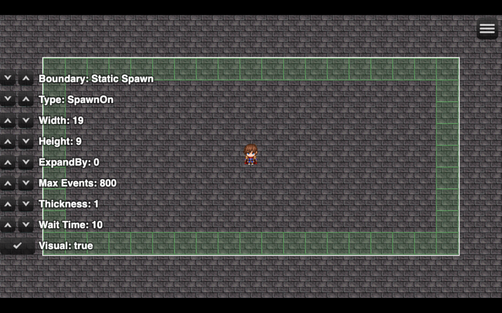
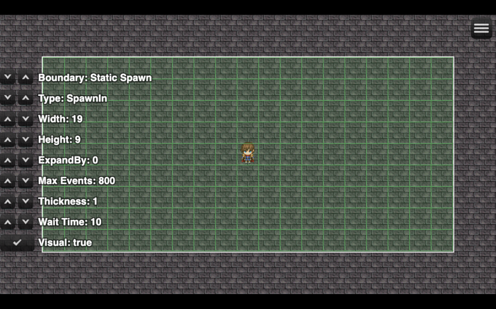
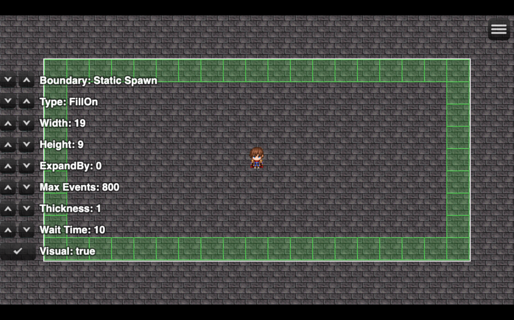
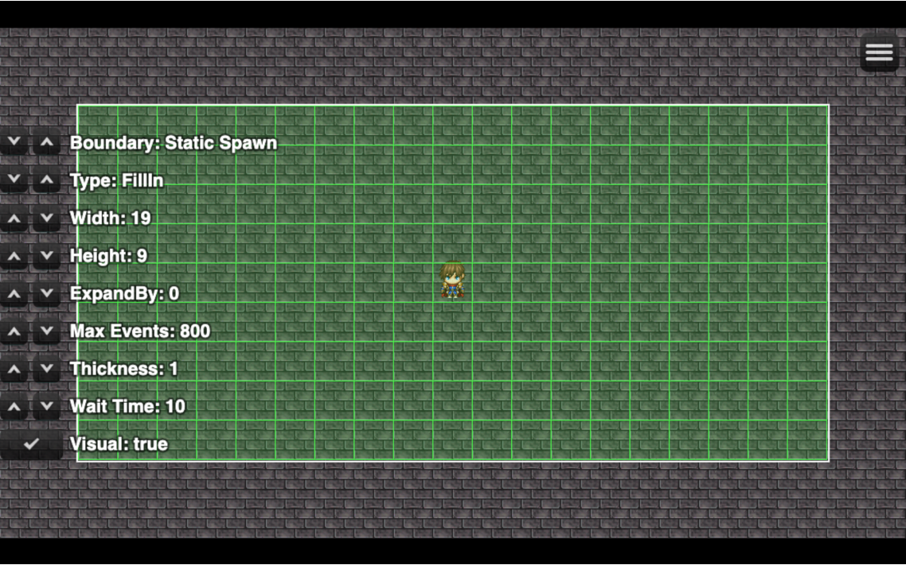
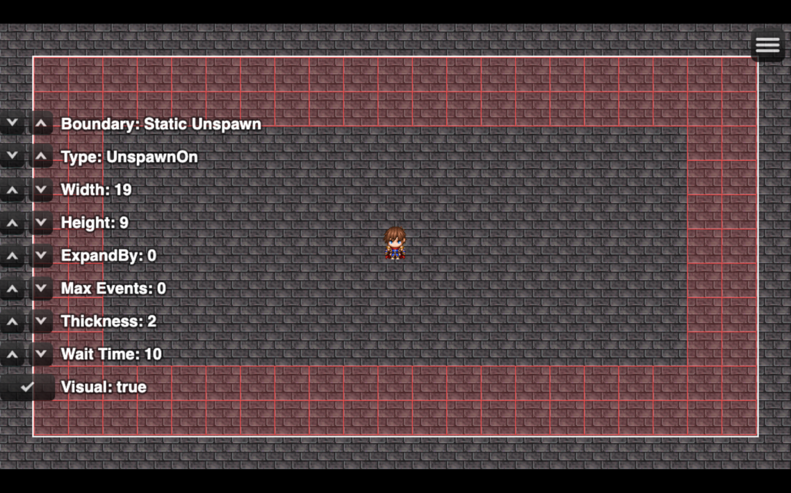
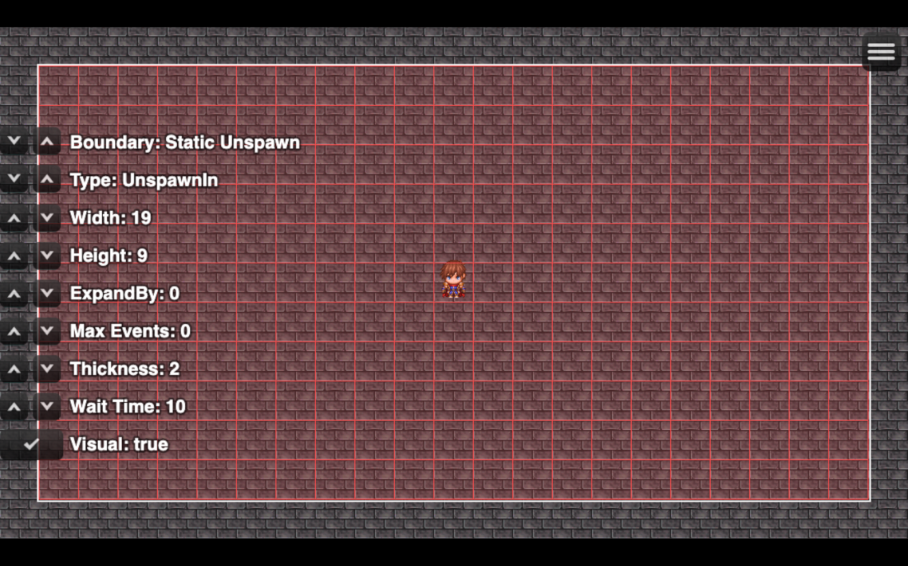

# Boundary Types

## Overview

The Ritter Boundary System supports **six boundary types**, each controlling how and where events are spawned or unspawned.

Boundary types determine:

- Which tiles are evaluated
- Whether events are spawned or unspawned
- Where saved boundary events can be restored
- How boundary thickness affects the evaluated area

Each type has a different behavior and visual footprint.

This page explains all six types, with screenshots showing their evaluated areas.

## Boundary Type Comparison

| Boundary Type | Action | Evaluated Area |
|---|---|---|
| `SpawnOn` | Spawn one event | Random eligible edge tile |
| `SpawnIn` | Spawn one event | Random eligible interior tile |
| `FillOn` | Spawn multiple events | Eligible edge tiles |
| `FillIn` | Spawn multiple events | Eligible interior tiles |
| `UnspawnOn` | Unspawn events | Boundary edge |
| `UnspawnIn` | Unspawn events | Boundary interior |

The distinction between **On** and **In** is important:

- **On** evaluates the boundary's edge.
- **In** evaluates the area inside the boundary.

**Spawn** attempts to create one new event per evaluation, while **Fill** attempts to populate the eligible tiles in its evaluated area.

**Unspawn** removes active boundary events from the evaluated area.

---

## Common Boundary Properties

All six boundary types share these properties:

- **Type:** Determines how the boundary behaves.
- **Width / Height:** Define the boundary's base dimensions.
- **Thickness:** Expands the boundary's evaluated area outward.

Thickness does not reduce the boundary's interior. Increasing it extends the evaluated area beyond the original boundary dimensions.

The screenshots below illustrate how these settings affect different boundary types.

---

## SpawnOn - Spawn Along the Edge

**Example Configuration:**

- Type: `SpawnOn`
- Width: 19
- Height: 9
- Thickness: 1

### Behavior

`SpawnOn` attempts to spawn **one event at a random eligible tile** along the boundary's edge.

When evaluated, it:

- Restores eligible saved boundary events found along the edge.
- Selects a random valid edge tile for a new event.
- Attempts to spawn one event that meets the configured spawning conditions.

### Thickness

Increasing thickness extends the evaluated edge outward, providing additional tiles where spawning can occur.

### Use Cases

- Randomized encounters around the player
- Controlled spawning with limited density
- Introducing creatures as the player explores

---

## SpawnIn - Spawn Inside the Boundary

**Example Configuration:**

- Type: `SpawnIn`
- Width: 19
- Height: 9
- Thickness: 1

### Behavior

`SpawnIn` attempts to spawn **one event at a random eligible tile** inside the boundary.

When evaluated, it:

- Restores eligible saved boundary events found within the area.
- Selects a random valid interior tile.
- Attempts to spawn one event that meets the configured spawning conditions.

Unlike `SpawnOn`, the new event can appear anywhere within the evaluated interior.

### Thickness

Increasing thickness expands the evaluated area outward, providing additional interior tiles for spawning.

### Use Cases

- Random encounters within an area
- Low-density NPC populations
- Dynamic interior event placement

---

## FillOn - Fill the Boundary Edge

**Example Configuration:**

- Type: `FillOn`
- Width: 19
- Height: 9
- Thickness: 1

### Behavior

`FillOn` attempts to spawn events across **every eligible tile along the boundary's edge**.

When evaluated, it:

- Checks the boundary's edge tiles.
- Restores eligible saved boundary events found on those tiles.
- Attempts to spawn new events according to the configured Boundary Event rules.

Unlike `SpawnOn`, which attempts one new event, `FillOn` can populate multiple eligible tiles during an evaluation.

### Thickness

Increasing thickness adds additional outward rings of edge tiles to the evaluated area.

### Use Cases

- Perimeter-based spawning
- Border guards and environmental objects
- Populating the edges of an area

---

## FillIn - Fill the Boundary Interior

**Example Configuration:**

- Type: `FillIn`
- Width: 19
- Height: 9
- Thickness: 1

### Behavior

`FillIn` attempts to spawn events across **every eligible tile inside the boundary**.

When evaluated, it:

- Checks tiles throughout the boundary's interior.
- Restores eligible saved boundary events within the area.
- Attempts to spawn new events according to the configured Boundary Event rules.

Unlike `SpawnIn`, which attempts one new event, `FillIn` can populate multiple eligible tiles during an evaluation.

### Thickness

Increasing thickness expands the evaluated interior outward, increasing the area available for spawning.

### Use Cases

- Populating areas with NPCs or interactable objects
- Filling zones with environmental details
- Preparing populated areas for gameplay

---

## UnspawnOn - Unspawn Along the Edge

**Example Configuration:**

- Type: `UnspawnOn`
- Width: 19
- Height: 9
- Thickness: 2

### Behavior

`UnspawnOn` evaluates the **boundary's edge** and unspawns applicable boundary events found there.

When evaluated, it:

- Checks the boundary's edge tiles.
- Unspawns applicable events located on those tiles.
- Preserves saved boundary event data for future restoration.

This type is especially useful when paired with a smaller spawn boundary.

As events move away from the player and reach the outer unspawn boundary, they can be removed from the active map.

### Thickness

Increasing thickness extends the evaluated edge outward, allowing the boundary to cover additional tiles.

### Use Cases

- Cleaning up events as the player explores
- Removing distant creatures and NPCs
- Maintaining an active event population around the player

---

## UnspawnIn - Unspawn Inside the Boundary

**Example Configuration:**

- Type: `UnspawnIn`
- Width: 19
- Height: 9
- Thickness: 2

### Behavior

`UnspawnIn` evaluates **the entire boundary interior** and unspawns applicable boundary events found within it.

When evaluated, it:

- Checks tiles throughout the boundary's interior.
- Unspawns applicable events located within the area.
- Preserves saved boundary event data for future restoration.

Unlike `UnspawnOn`, which evaluates the edge, `UnspawnIn` operates throughout the evaluated area.

### Thickness

Increasing thickness expands the evaluated area outward.

### Use Cases

- Clearing populated areas
- Removing events throughout a zone
- Managing event populations across large areas

---

## Choosing the Right Boundary Type

The best boundary type depends on how you want events to appear or disappear.

For example:

- Use `SpawnOn` to introduce creatures along the edge of the player's surroundings.
- Use `SpawnIn` to place occasional events randomly within an area.
- Use `FillOn` to populate the perimeter of a region.
- Use `FillIn` to populate an entire area.
- Use `UnspawnOn` to remove events as they reach the edge of a larger cleanup boundary.
- Use `UnspawnIn` to clear events throughout a selected area.

You can combine multiple boundaries to create more advanced spawning and event streaming behavior.

For a practical introduction to using boundaries together, see the [Boundary System Introduction](../../Guides/Boundary/introduction.html).

For implementation details, see [Boundary Plugin Commands](plugincommands.html) and [Boundary Script Calls](scriptcalls.html).
