# Boundary System Plugin Commands Documentation
MZ Only 
{: .label .label-blue }

The Ritter Boundary System includes plugin commands for RPG Maker MZ, allowing you to create, configure, and manage boundaries directly through the event editor.

These commands appear under **Ritter_EventSpawner** in the Plugin Command menu. Make sure **Ritter_BoundarySystem** is installed and placed above **Ritter_EventSpawner** in your Plugin Manager.

This guide explains what each command does, how to configure its arguments, and when you might want to use it. The accompanying screenshots show the available settings in RPG Maker MZ.

**Using RPG Maker MV?** Boundary features are available through [Script Calls](scriptcalls.html). The Boundary Event Setup section below also explains how to configure event templates in MV.

## Table of Contents

- [Create Boundary](#create-boundary)
- [Add Auto Handler](#add-auto-handler)
- [Boundary Event Setup](#boundary-event-setup)
- [Init Boundary Events](#init-boundary-events)
- [Activate Boundary](#activate-boundary)
- [Deactivate Boundary](#deactivate-boundary)
- [Enable Event / Disable Event](#enable-event--disable-event)
- [Edit Spawner Boundary](#edit-spawner-boundary)
- [Preload Saved Boundary Event](#preload-saved-boundary-event)
- [Preload Saved Boundary Event (Region)](#preload-saved-boundary-event-region)

---

## Create Boundary

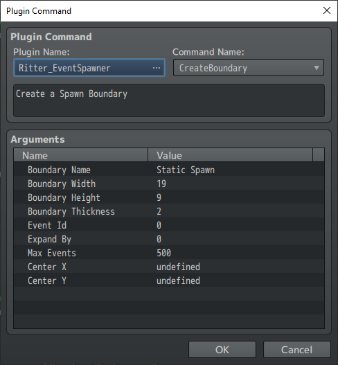

Use **Create Boundary** to create a new boundary with a name, size, position, and event limit.

Boundaries can follow the player, follow an event, or remain at a fixed location on the map.

### Command Arguments

| Argument | Description |
|---|---|
| `Name` | A unique name for the boundary. You'll use this name to reference it in other commands. |
| `Width` | The width of the boundary in map tiles. |
| `Height` | The height of the boundary in map tiles. |
| `Thickness` | How far the boundary's edge extends outward. |
| `EventId` | Determines whether the boundary follows the player, an event, or a fixed location. |
| `ExpandBy` | Additional expansion in the player's movement direction, when applicable. |
| `MaxEvents` | Maximum number of events the boundary can spawn automatically. |
| `CenterX` | The boundary's X coordinate when using a fixed location. |
| `CenterY` | The boundary's Y coordinate when using a fixed location. |

### Choosing What the Boundary Follows

The `EventId` argument determines what anchors the boundary.

| EventId | Behavior |
|---|---|
| `0` | Follow the player. |
| A positive event ID | Follow the specified event. |
| `-1` | Remain at a fixed location using `CenterX` and `CenterY`. |

For example, setting `EventId` to `0` creates a boundary that moves with the player.

Setting it to `-1` allows you to create a boundary centered on specific map coordinates instead.

### Important Settings

**MaxEvents:** Use a positive number when configuring automatic spawning. A value of `0` does not mean unlimited events.

**Boundary Name:** Choose a meaningful name, such as `NPCs`, `Enemies`, or `Resources`. If the boundary owns persistent events, keep its name consistent so those events can be found and restored later.

**Default Values:** The MZ plugin command defaults to `EventId = 0`, `ExpandBy = 1`, and `MaxEvents = 30`. Script calls use different defaults (`-1`, `0`, and `0` respectively), so specify your preferred values when creating boundaries.

After creating a boundary, use **Add Auto Handler** to configure how it will spawn or unspawn events.

---

## Add Auto Handler

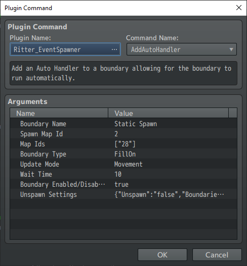

Use **Add Auto Handler** to tell an existing boundary what it should do automatically.

For example, you can configure a boundary to spawn enemies as the player moves, restore saved NPCs, or unspawn events that are no longer nearby.

### Command Arguments

| Argument | Description |
|---|---|
| `Name` | The name of an existing boundary to configure. |
| `SpawnMap` | The map ID containing the template events used for spawning. |
| `Maps` | The gameplay map IDs where this handler should operate. |
| `Type` | Determines how the boundary spawns or unspawns events. |
| `UpdateMode` | Determines when the boundary checks for updates. |
| `Wait` | Number of frames between checks when using `WaitTime` mode. |
| `Enabled` | Whether the handler starts enabled on its configured maps. |
| `UnspawnSettings` | Configures which spawn boundaries an unspawn handler can remove events from. |

### Boundary Types

The `Type` argument provides six options:

| Type | Behavior |
|---|---|
| `SpawnOn` | Attempts to spawn one event along the boundary's edge. |
| `SpawnIn` | Attempts to spawn one event inside the boundary. |
| `FillOn` | Attempts to fill eligible tiles along the boundary's edge with events. |
| `FillIn` | Attempts to fill eligible tiles inside the boundary with events. |
| `UnspawnOn` | Unspawns matching boundary events along the boundary's edge. |
| `UnspawnIn` | Unspawns matching boundary events inside the boundary. |

See [Boundary Types](boundarytypes.html) for more information about how each type works.

### Update Modes

**WaitTime:** The handler checks for updates at the interval specified by `Wait`, measured in frames.

**Movement:** The handler updates based on movement rather than a timed interval. The `Wait` argument is not a movement cooldown.

Choose the update mode that best suits your game's needs.

### Configuring an Unspawn Boundary

If you're creating an unspawn handler, open **Unspawn Settings**.

1. Enable the **Unspawn** option.
2. Under **Boundaries**, enter the names of the spawn boundaries whose events should be removed.
3. Choose either `UnspawnOn` or `UnspawnIn` as the handler type.

For example, if you have spawn boundaries named `NPCs` and `Resources`, you can configure a larger unspawn boundary to remove events belonging to both.

**Important:** Enter the exact names of the spawn boundaries you want to manage, not the name of the unspawn boundary itself.

For an unspawn-only handler, `SpawnMap` can be set to `0` because it does not need a source template map.

---

## Boundary Event Setup

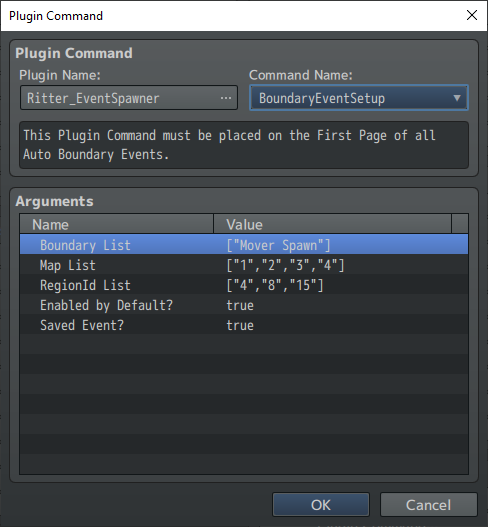

Use **Boundary Event Setup** to configure a template event for automatic boundary spawning.

This command belongs on **page 1 of the template event** on your spawn map.

It tells the Boundary System which boundaries are allowed to generate the event, which gameplay maps it can appear on, and whether spawned copies should be saved.

**This command does not spawn an event by itself.** It configures the template for use by automatic boundary spawning.

### Command Arguments

| Argument | Description |
|---|---|
| `BoundaryList` | Names of the spawn boundaries allowed to generate this event. |
| `MapList` | Gameplay map IDs where the event may be generated. |
| `RegionsList` | Region IDs where the event is allowed to spawn. |
| `Enabled` | Whether the template is initially available for automatic spawning. |
| `Save` | Whether newly generated events should be saved as persistent boundary events. |

### Example

Imagine you have an NPC template on a spawn map.

You could configure it with:

- **BoundaryList:** `NPCs`
- **MapList:** `1`
- **RegionsList:** `1, 3`
- **Enabled:** `true`
- **Save:** `true`

This allows the `NPCs` boundary to generate the template on gameplay map 1, using region IDs 1 and 3.

Because `Save` is enabled, generated NPCs can retain their persistent boundary event data.

**Note:** Boundary Event Setup is intended for automatic generation of new events. You do not need to add it simply to create an event through the explicit preload commands.

### RPG Maker MV Setup

RPG Maker MV does not have MZ's structured Plugin Command interface, but you can configure template events using a traditional MV Plugin Command.

Place the following command on **page 1 of the template event**:

```text
Ritter_EventSpawner BoundaryEventSetup {"BoundaryList":["NPCs"],"MapList":[1],"RegionsList":[1,3],"Enabled":true,"Save":true}
```

This configures the same template settings described above.

The metadata also accepts the JSON-encoded array strings and `"true"` / `"false"` values used by MZ.

For other Boundary System operations in MV, use the available [Script Calls](scriptcalls.html).

For more information about persistent events, see [Saved Boundary Events](savedboundaryevents.html).

---

## Init Boundary Events

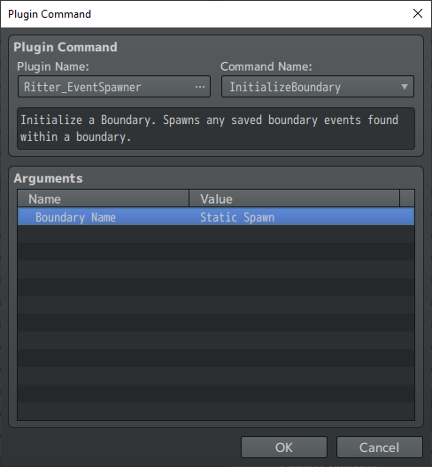

Use **Init Boundary Events** to populate an active spawn boundary with saved or preloaded events.

This is particularly useful when you want events to appear immediately instead of waiting for normal boundary movement to trigger spawning.

### Command Arguments

| Argument | Description |
|---|---|
| `Name` | The name of the active spawn boundary to initialize. |

### Example

Imagine you've preloaded NPCs throughout a village.

When the player first enters the village, you want nearby NPCs to appear immediately.

After setting up the preloaded events and activating the appropriate spawn boundary, use **Init Boundary Events** to restore eligible saved events inside that boundary.

The command processes stored events within the boundary's interior, up to its configured capacity. This works even if the boundary normally uses an edge-based spawning type such as `SpawnOn` or `FillOn`.

It does not generate a new event on every empty tile or activate every saved event in the world.

### Important Notes

- The spawn boundary must be active before it can be initialized.
- Use initialization when you want to populate the starting area with existing saved or preloaded events.
- Previously active persistent events are restored automatically when loading a saved game.
- You do not need to repeatedly initialize boundaries just to restore events when continuing a saved game.

See [Preloaded Boundary Events](preloadevents.html) for more information.

---

## Activate Boundary

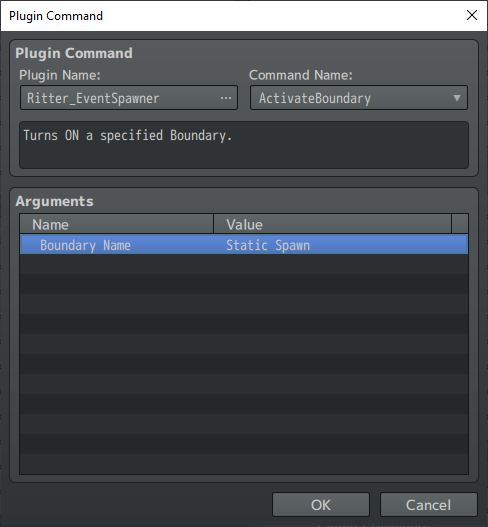

Use **Activate Boundary** to enable an existing boundary's automatic processing.

### Command Arguments

| Argument | Description |
|---|---|
| `Name` | The name of the boundary to activate. |

For example, you might keep an enemy spawning boundary inactive until the player enters a particular area or completes an objective.

Activating the boundary allows it to begin processing according to its configured handler, update mode, and event limit.

**Note:** Activating a boundary does not automatically spawn every saved event it owns. Normal spawning and restoration rules still apply.

---

## Deactivate Boundary

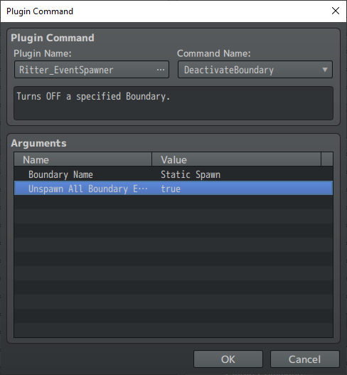

Use **Deactivate Boundary** to stop an existing boundary from processing automatic updates.

You can choose whether its currently active events should remain on the map or be unspawned.

### Command Arguments

| Argument | Description |
|---|---|
| `Name` | The name of the boundary to deactivate. |
| `UnspawnAll` | Whether to unspawn the boundary's currently active events when deactivating it. |

### UnspawnAll Options

**False:** The boundary stops processing, but its currently active events remain on the map.

**True:** The boundary stops processing and unspawns its currently active events.

Saved boundary events retain their persistent data for future restoration. Temporary events are removed without retaining persistent state.

### Example

Imagine an area containing enemies controlled by a boundary.

When the player defeats the area's boss, you could deactivate the enemy boundary to prevent further automatic spawning.

If you also enable `UnspawnAll`, the boundary's remaining active enemies will be unspawned.

---

## Enable Event / Disable Event

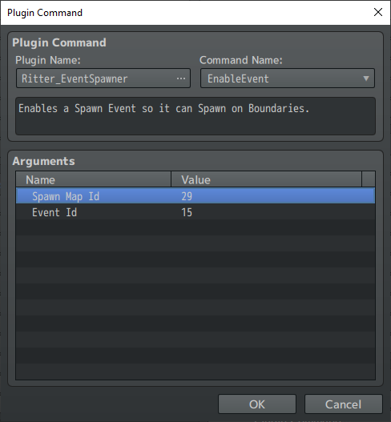

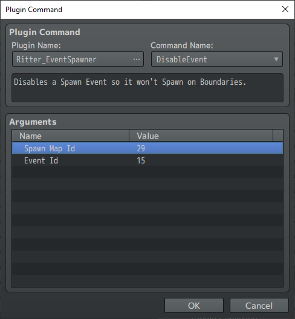

Use **Enable Event** and **Disable Event** to control whether a particular template event can be selected for new automatic boundary spawns.

This is useful when you want to change which types of events can appear as the game progresses.

### Command Arguments

| Argument | Description |
|---|---|
| `SpawnMap` | The map ID containing the template event. |
| `EventId` | The ID of the template event to enable or disable. |

### Example

Imagine your game has several enemy templates on a spawn map.

Early in the game, you might allow the boundary to generate weaker enemies.

After the player reaches a certain level, you could disable some weaker templates and enable stronger ones.

This changes which templates are eligible for **new automatically generated events**.

**Important:** Disabling a template does not delete existing saved boundary events, remove preloaded events, or disable an individual NPC identified by a BEID.

---

## Edit Spawner Boundary

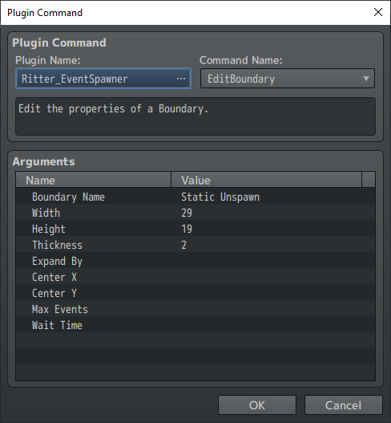

Use **Edit Spawner Boundary** to modify an existing boundary without recreating it.

You can change its dimensions, position, event limit, and other settings while the game is running.

### Command Arguments

| Argument | Description |
|---|---|
| `Name` | The name of the boundary to modify. |
| `Width` | Change the boundary's width. |
| `Height` | Change the boundary's height. |
| `Thickness` | Change the boundary's outward edge thickness. |
| `ExpandBy` | Change the boundary's directional expansion setting. |
| `X` | Change the X coordinate of a fixed-position boundary. |
| `Y` | Change the Y coordinate of a fixed-position boundary. |
| `MaxEvents` | Change the boundary's automatic spawning limit. |
| `WaitTime` | Change the update interval for a timed handler. |

### Editing Individual Settings

You don't need to enter every argument when editing a boundary.

**Leave an optional field empty** to keep its current value.

For example, if you only want to increase the boundary's width, enter the new `Width` value and leave the other optional fields empty.

Entering `0` is different from leaving a field empty. A value of `0` explicitly changes that setting to zero.

### Example Uses

You could use this command to:

- Expand a boundary when the player enters a larger area.
- Increase the maximum enemy population as the game becomes more difficult.
- Move a fixed-position boundary to another location.
- Adjust how frequently a timed boundary checks for updates.

**Important:** Making a boundary smaller does not automatically unspawn events that are now outside its area. Make sure your unspawn boundaries are configured to handle those events.

---

## Preload Saved Boundary Event

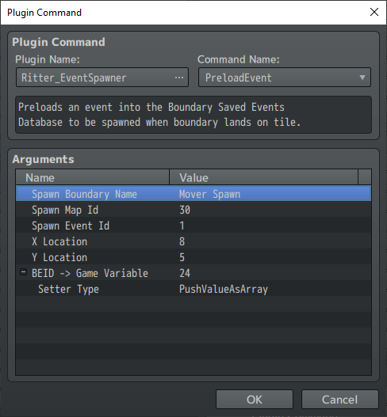

Use **Preload Saved Boundary Event** to create a persistent boundary event at specific map coordinates without immediately spawning it onto the active map.

This allows you to prepare NPCs, treasure chests, resources, and other persistent objects before the player encounters them.

The event is stored for later restoration through the Boundary System.

### Command Arguments

| Argument | Description |
|---|---|
| `BoundaryName` | The name of the spawn boundary that will own the saved event. |
| `SpawnMap` | The map ID containing the template event. |
| `SpawnEventId` | The ID of the template event to preload. |
| `XPosition` | The X coordinate where the saved event will be placed. |
| `YPosition` | The Y coordinate where the saved event will be placed. |
| `varBEID` | Game variable ID used to receive the new event's BEID. Set to `0` to disable output. |
| `varType` | Determines how the BEID is stored in the selected game variable. |

### Example Setup

Imagine you want to preload a persistent NPC at coordinates `(8, 10)` on the current gameplay map.

Configure the command as follows:

| Setting | Value |
|---|---|
| BoundaryName | `Static Spawn` |
| SpawnMap | `2` |
| SpawnEventId | `1` |
| XPosition | `8` |
| YPosition | `10` |
| varBEID | `1` |
| varType | `SetValueAsInteger` |

When the preload succeeds, the event receives a persistent Boundary Event ID (BEID).

Because `varBEID` is set to `1`, the new BEID is stored in game variable 1.

You can retrieve it with:

```js
const beid = $gameVariables.value(1);
```

**This is the event's BEID, not its regular RPG Maker event ID.**

To identify the saved event later, retain its boundary name, gameplay map ID, and BEID.

### Choosing How to Store the BEID

The `varType` argument provides two options:

**SetValueAsInteger**

Stores the new BEID directly in the selected game variable.

This is useful when you only need to track one newly created event.

**PushValueAsArray**

Adds the new BEID to an array stored in the selected game variable.

If the variable does not already contain an array, the plugin initializes one.

This is useful when preloading several events and collecting their BEIDs for later use.

### Important Notes

- Preloading creates a saved event record without immediately making the event appear on the map.
- The specified location must not already contain another saved event or preload belonging to the same boundary and gameplay map.
- Use valid template map IDs, event IDs, and coordinates.
- Preloading does not perform every normal spawning or terrain passability check.
- If preload creation fails, no new BEID is returned. The output variable may still contain an older value.

If you need to check whether a preload succeeded, don't assume an existing value in the output variable belongs to the latest attempt.

For more information, see [Preloaded Boundary Events](preloadevents.html).

---

## Preload Saved Boundary Event (Region)

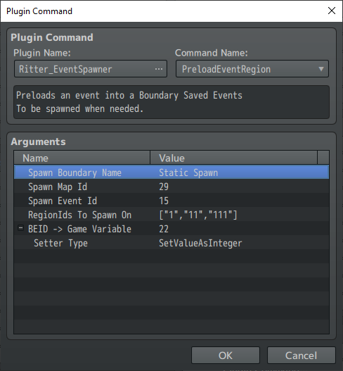

Use **Preload Saved Boundary Event (Region)** to create a persistent boundary event on a randomly selected tile matching one of your chosen region IDs.

This works similarly to the coordinate-based preload command, except you select region IDs instead of entering exact X and Y coordinates.

It's especially useful when you want to populate a map with persistent events without choosing every location manually.

### Command Arguments

| Argument | Description |
|---|---|
| `BoundaryName` | The name of the spawn boundary that will own the saved event. |
| `SpawnMap` | The map ID containing the template event. |
| `SpawnEventId` | The ID of the template event to preload. |
| `Regions` | One or more region IDs where the event may be placed. |
| `varBEID` | Game variable ID used to receive the new event's BEID. Set to `0` to disable output. |
| `varType` | Choose whether to store the BEID directly or add it to an array. |

### Example Setup

Imagine you want to preload a persistent NPC somewhere within region 1 of your current gameplay map.

First, use RPG Maker's Region tool to paint region ID `1` onto the tiles where the NPC is allowed to appear.

Then configure the command:

| Setting | Value |
|---|---|
| BoundaryName | `Static Spawn` |
| SpawnMap | `2` |
| SpawnEventId | `1` |
| Regions | `[1]` |
| varBEID | `1` |
| varType | `SetValueAsInteger` |

When the command succeeds, it creates **one saved boundary event** at a randomly selected eligible tile matching region 1.

The new event's BEID is stored in game variable 1.

You can also specify multiple region IDs to allow placement across different areas.

### Important Notes

- Each command execution creates one preload, not one event per matching tile.
- Region selection searches the current gameplay map, including matching tiles outside the boundary's current area.
- The selected tile must be eligible for the preload.
- If no suitable tile is found, no event is created.
- If creation fails, the output variable is left unchanged.
- Invalid region data prevents the command from creating a preload.

Like the coordinate-based version, this command prepares the saved event for later restoration rather than immediately spawning it.

See [Preloaded Boundary Events](preloadevents.html) for more information about how preloaded events are stored and restored.

For script examples involving BEIDs and saved event management, see [Preloading and BEID Control](scriptcalls.html#9-preloading-and-beid-control).
