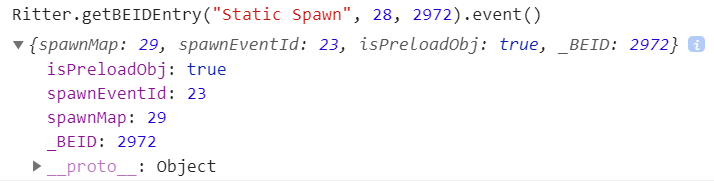

# Preloaded Boundary Events

Preloads prepare persistent boundary entities without immediately creating live map events or sprites. Basic preload helpers already existed in EventSpawner v2.0a; v2.1 adds name-based public wrappers, MZ preload commands, BEID identity, and self-variable transfer.

A preload saves event-update/sprite work while dormant, but still costs storage, memory, placement lookup, and save/load processing. It is not zero-cost or an unlimited-performance guarantee.

## Create a preload

Create and configure a Spawner boundary first. The following example assumes `NPCs` exists on the current map and template map 2/event 1 is valid:

Full argument tables, lower-level boundary-object calls, and returned-entry examples are in [Preloading and BEID Control](scriptcalls.html#9-preloading-and-beid-control).

```js
const record = Ritter.preloadEvent("NPCs", 2, 1, 8, 10);
if (record) {
    $gameVariables.setValue(22, record._BEID);
    Ritter.setSelfVariable("NPCs", $gameMap.mapId(), record._BEID, "met", false);
}
```

For region placement:

```js
const record = Ritter.preloadEventRegion("NPCs", 2, 1, [1, 3]);
if (record) $gameVariables.setValue(22, record._BEID);
```

Region selection covers matching tiles across the current map, including tiles outside the boundary's present footprint. It is not a request to fill every region tile or every map. The name-based region wrapper accepts a numeric region ID or an array; the lower-level `preloadSavedEventRegion` requires an array. Call once per desired new entity, checking each result; repeating setup on every map visit can add unwanted persistent records.

## Placement restrictions

A new preload requires an empty saved-event tile for that boundary/map. If that tile already holds a saved clone or preload, creation returns no record. Different boundaries may store entries at the same coordinates. Saved clones can later share a tile; this does not remove the new-preload placement restriction.

Coordinate insertion and region selection return `null` for occupied saved tiles or unavailable region candidates. The name-based wrappers warn and return `undefined` for missing/unknown boundary names. Neither form fully validates templates, coordinates, passability, or live-event occupancy. Supply valid numeric template IDs and in-bounds tiles; a successful metadata insertion alone does not prove the template can spawn.

A preload is always a persistent saved boundary entity when promoted. Fresh automatic temporary populations should use template rules instead.

## What the record contains



| Field | Meaning |
| --- | --- |
| `isPreloadObj` | `true` for a preload. A live/dormant Game_Event normally has no such flag; `false` is not a live-state test. |
| `_BEID` | Numeric identity scoped by boundary and gameplay map. |
| `mapId`, `x`, `y` | Owning gameplay map and placement tile. |
| `spawnMap`, `spawnEventId` | Source template IDs. |
| `_parentBoundary` | Owning boundary. |

Store `_BEID` together with the boundary name and gameplay map ID, not `preload.eventId()` or a runtime ID. The preload is a plain record with no `Game_Event` methods. Output game variables are unchanged on failure, so do not mistake a previous BEID for a newly created entity.

These are inspection fields, not general setters. Do not change placement/ownership fields or insert raw objects into the saved database. Use [self variables](selfvariables.html) for supported custom data.

## When it becomes live

Normal active-boundary streaming selects stored tiles according to [boundary type](boundarytypes.html) and capacity. The first spawn preserves the BEID and preload self variables. Subsequent unspawns retain a saved event clone rather than returning to a never-instantiated preload.

For immediate eligible interior restoration after initial population setup:

```js
Ritter.Boundary.activate("NPCs");
Ritter.Boundary.initBoundaryEvents("NPCs");
```

For deliberate restoration of one entity, `Ritter.restoreByBEID("NPCs", BEID)` uses its stored tile on the current map. This bypasses normal automatic geometry/cap selection; use it intentionally rather than as a bulk world refresh.

## Save/load behavior

A preload remains a preload across game save/load until it is selected for spawning. Restoring a save does not instantiate the entire persistent collection. Previously live persistent boundary events are restored live independently of dormant/preload streaming, including a same-map version rebuild.

Keep template IDs valid, and back up all referenced external chunks with the main save. See [Save Storage & Restoration](../persistence.html).
