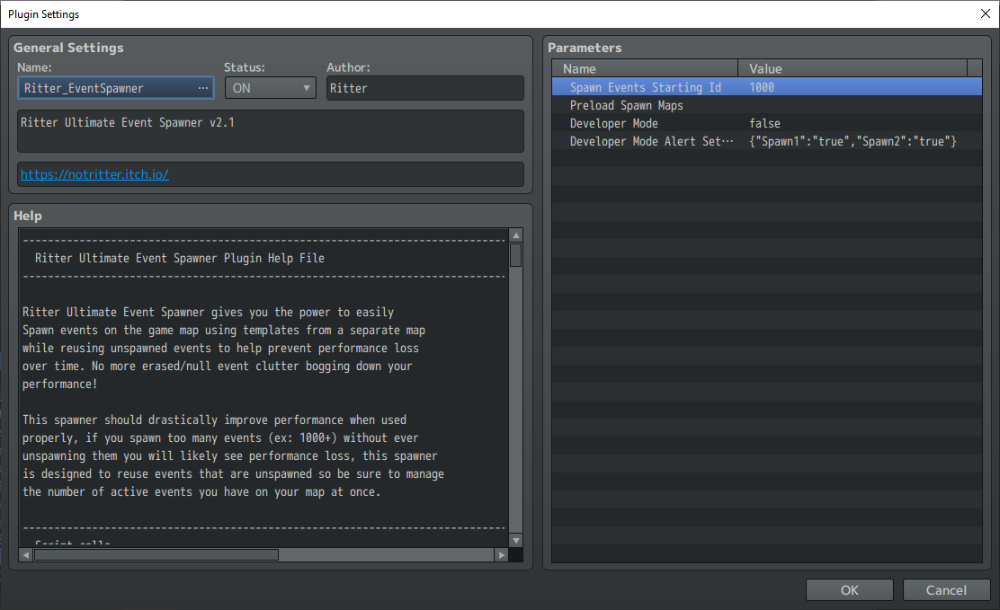

# Installation

Ritter Ultimate Event Spawner v2.1 supports RPG Maker MV and MZ. The Boundary System is an optional companion: install it when using boundary streaming, BEIDs, preloads, or boundary self variables.

## 1. Install the files

Place the purchased plugin files in your project's `js/plugins/` folder. Keep their filenames unchanged. Enable them in Plugin Manager in this order:

```text
Ritter_BoundarySystem
Ritter_EventSpawner
```

For base spawning alone, enable only `Ritter_EventSpawner`. The companion source currently identifies itself as Boundary System 1.5; its version number is independent of EventSpawner v2.1.


## 2. Configure Plugin Parameters

| Parameter | Current behavior |
| --- | --- |
| Spawn Events Starting Id | First ID considered for newly allocated spawn slots; default `1000`. Choose an integer above your editor-placed event IDs. Retained base saved events reserve their IDs. |
| Preload Spawn Maps | Retained parameter accepting space-separated map IDs. The current boot loader reads **all maps listed in MapInfos**, not only this list. Changing the list does not restrict the template cache. |
| Boundary Save Settings | `externalSave` chooses external chunks for dormant boundary records; `externalSaveCount` is a positive integer record count per chunk, normally `4000`. This is not a live-event cap or a byte limit. |
| Streaming Quick Start | Creates configured spawn/unspawn boundaries. Each Spawn Boundary has its own **Spawn Map ID** for source templates; the shared **Map IDs** list identifies gameplay destinations. See [Quick Start setup](#quick-start-setup). |

The former Developer Mode / Developer Mode Alert Settings parameters are not read as active release settings by the current implementation. Old screenshots may show them; do not rely on those alerts for validation.



### Quick Start setup

Open **Ritter_EventSpawner → Event Streaming Quick Start** in Plugin Manager. This setup requires the Boundary companion and uses the same parameter parser in MV and MZ.

1. Set **Map IDs** (`QuickStream.Maps`) to the gameplay maps where the boundaries should operate.
2. Open **Spawn Boundaries**, then each entry. Set **Spawn Map ID** (`SpawnBoundary.SpawnMap`) to the map containing that boundary's template events. The editor supplies a default of `1`; choose your actual source map.
3. Set its unique Name, Distance, Thickness, Type, Update Mode, Wait Time, Max Events, and Enabled flag.
4. Configure **Unspawn Boundaries** with the exact owning spawn-boundary names under **Target Spawn Boundaries**. They use an edge unspawn handler and need no template-map setting. Give the outer cleanup boundary sufficient Distance to surround its target spawn zones.
5. Enable Quick Start and test a New Game.

For example, with **Map IDs = `[5]`**:

| Spawn Boundary Name | Spawn Map ID | Meaning |
| --- | --- | --- |
| Forest | `2` | Generate Forest's events from templates on map 2, for gameplay map 5. |
| Town | `3` | Generate Town's events from templates on map 3, for gameplay map 5. |

An unspawn boundary targeting `["Forest", "Town"]` removes events owned by those boundaries. It does not choose a template map. These map IDs are examples; use existing maps in your project.

For generated populations, place [BoundaryEventSetup metadata](Boundary/plugincommands.html#boundary-event-setup) on page 1 of each source template. Match its Boundary List to the owning boundary name, keep its Map List aligned with the Quick Start gameplay Map IDs, and set eligible regions. Source-map selection does not replace these spawning rules. Preloaded populations continue using their stored template references.

Quick Start starts disabled. A new SpawnBoundary struct entry defaults to **Spawn Map ID 1** and **Max Events 400**. The top-level Quick Start preset currently supplies source map `2` for both named spawn entries, with Max Events `500` for Static Spawn and `300` for Mover Spawn. Existing serialized settings are not replaced by header defaults; review every entry for your project.

These are separate from the intentional script-call defaults `expandBy = 0` and `maxEvents = 0`. Set Max Events explicitly: the parser uses `800` if that field is omitted from serialized settings. The nested QuickStream list presets omit MaxEvents, so they can differ from the complete top-level preset.

**Validation:** when Quick Start is enabled, every named Spawn Boundary must specify a positive integer Spawn Map ID identifying a loaded project map. Missing, blank, zero, negative, fractional, nonnumeric, or nonexistent IDs stop setup with an error naming the boundary before any Quick Start boundaries are created. This also applies to entries whose individual Enabled flag is off. Disabling Quick Start globally creates nothing and bypasses this setup validation.

**Existing development settings:** Quick Start was unreleased. Open each existing Spawn Boundary entry and set Spawn Map ID manually, or recreate the entry in Plugin Manager. There is no migration, missing-value fallback, or dependency on sample map 30.

Quick Start creates boundaries only when their names are absent. Changing parameters does not retarget an existing saved boundary or migrate its persistent population. Use a New Game when verifying revised development settings; game save/load retains established boundaries, identities, and source maps.

## 3. Create a Template Map for Source Events

1. Create a normal RPG Maker map containing your source events.
2. Give templates distinct names if you plan to spawn by name.
3. Configure their pages, graphics, commands, and conditions normally.
4. Spawn copies from gameplay maps; do not use the template map as your population manager.

Template maps must remain available in the project. Boot waits for the template-map cache before New Game or Continue. A missing or invalid referenced map file is an error, not a reason to continue with incomplete templates.


## 4. Test a basic spawn

On a gameplay map, use an event's Script command in either engine. Replace map/event IDs and coordinates with valid values:

```js
const spawned = Ritter.spawnEvent(2, 1, 8, 10, false, false);
if (spawned) {
    $gameVariables.setValue(21, spawned.eventId());
}
```

The call requires a map scene. It returns a live event on success or no event if placement cannot proceed. It does not move the player or promise tile passability. See [placement rules](spatial.html).

## 5. Choose the engine interface

* **MV:** use Script commands for the public JavaScript APIs. The template-only `BoundaryEventSetup` metadata form is documented [here](Boundary/plugincommands.html#rpg-maker-mv-metadata).
* **MZ:** use the Script commands or the editor's plugin-command UI. Command outputs are available to the following event command.

For persistent boundary populations, create/configure a spawn boundary, configure its auto handler, then [preload events](Boundary/preloadevents.html). If you want eligible dormant entries instantiated immediately, explicitly initialize the active boundary once. Loading already-live saved events does not require a manual refresh or player movement.

## Upgrading and save handling

Back up your complete project and saves before changing plugins. Use the matching Spawner/Boundary files together. Review [upgrading to v2.1](upgrading.html) and [save storage](persistence.html), especially when moving external chunk files or supporting existing player saves.

## Next Steps

* [Script Calls](scriptcalls.html)
* [Plugin Commands](plugincommands.html)
* [Spawn Maps & Templates](spawnmapsandtemplates.html)
* [Boundary Introduction](../Guides/Boundary/introduction.html)
* [Developer Integration Guide](../compatibility.html)
