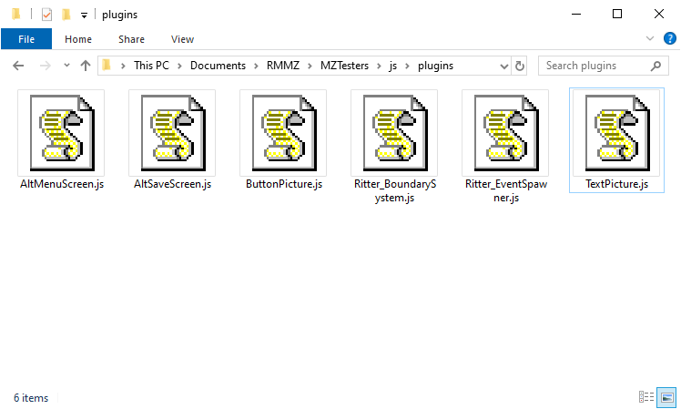
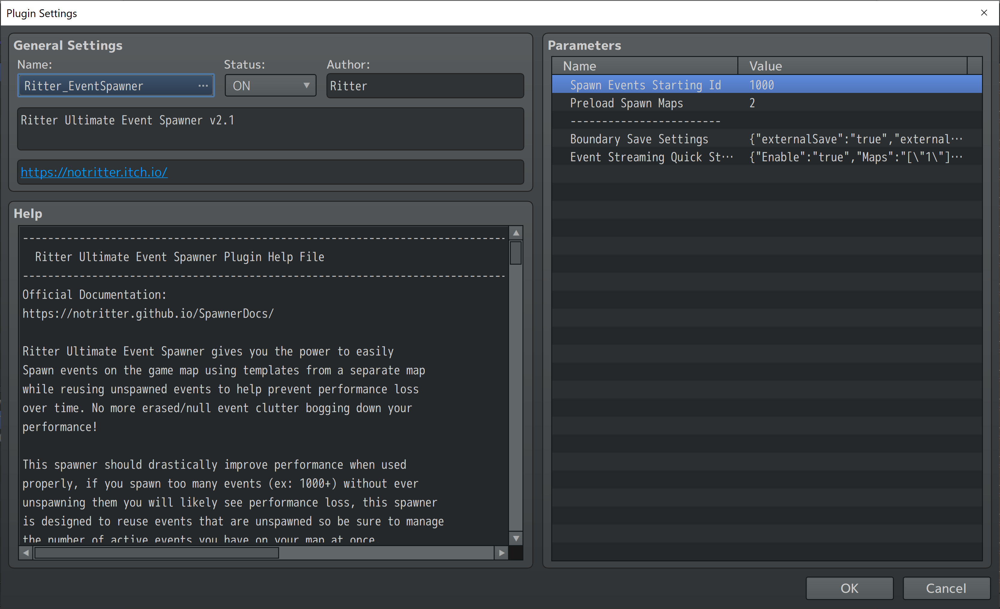
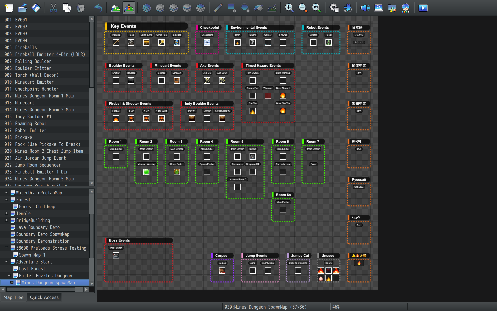

# Installation

**Ritter Ultimate Event Spawner v2.1** supports both RPG Maker MV and MZ.

The Event Spawner allows you to create, transform, and manage events dynamically. Its optional companion, **Ritter Boundary System**, adds automatic event streaming, persistent BEIDs, preloading, and boundary Self Variables.

You only need the Boundary System if you plan to use those additional features.

## 1. Install the Plugin Files

Place the purchased plugin files in your project's `js/plugins/` folder. Keep their filenames unchanged.

If you're using both plugins, enable them in Plugin Manager in this order:

```text
Ritter_BoundarySystem
Ritter_EventSpawner
```

**Important:** The Boundary System must be placed above Event Spawner.

If you only need basic event spawning, you can enable `Ritter_EventSpawner` by itself.

When using the Boundary System, install the companion version supplied with your Event Spawner update. The two plugins have separate version numbers.



---

## 2. Configure Plugin Parameters

Open **Ritter_EventSpawner** in RPG Maker's Plugin Manager.

The following settings are worth reviewing before using the plugin:

| Parameter | Description |
|---|---|
| **Spawn Events Starting Id** | The starting runtime event ID used for newly spawned events. Defaults to `1000`. Choose a number higher than the IDs of events placed in your map editor. |
| **Preload Spawn Maps** | Retained for compatibility with older settings. All project maps are now loaded for use as templates, so you don't need to list individual source maps here. |
| **Boundary Save Settings** | Controls how persistent boundary event data is saved. By default, `externalSave` is disabled, keeping boundary data in the regular game save. Enabling it uses additional save files. |
| **Event Streaming Quick Start** | Optional configuration for automatically creating spawn and unspawn boundaries. Requires the Boundary System. |

### Spawn Events Starting Id

The default starting event ID is `1000`.

For example, if your gameplay map contains editor-created events with IDs `1` through `75`, the default starting ID leaves plenty of room for dynamically spawned events.

Base saved events may reserve their runtime IDs for later restoration.

### Boundary Save Settings

If you're using the Boundary System, you can choose how its persistent event data is stored.

- **External Save Disabled:** Boundary data is included in the regular game save.
- **External Save Enabled:** Boundary data is stored using additional save files.

When external saving is enabled, `externalSaveCount` controls how many records are stored per file. Its normal default is `4000`.

If you use external saves, make sure to follow the [External Save Backup Instructions](Boundary/savedboundaryevents.html#backing-up-and-transferring-external-saves) when backing up or transferring saved games.

### Event Streaming Quick Start

Quick Start provides an easier way to configure automatic event streaming without writing boundary setup scripts.

It's completely optional and is covered in [Section 5](#5-configure-event-streaming-quick-start-optional).



---

## 3. Create a Template Map

Before spawning events, you'll need a map containing the events you want to use as templates.

These are ordinary RPG Maker events that the Event Spawner can copy onto your gameplay maps.

### Creating a Template Map

1. Create a new map in RPG Maker.
2. Add the events you want to spawn.
3. Configure their graphics, pages, conditions, and event commands normally.
4. Give your templates recognizable names if you plan to spawn them by name.

For example, you could create a map called `SpawnMap` containing templates for Slimes, NPCs, treasure chests, and other objects.



### Important Notes

Template maps are used as sources for spawned events.

You don't need to place every template event on your gameplay maps manually. Instead, the Event Spawner creates copies of them when requested.

Keep your template maps in the project, even if players never visit them directly.

**Important:** The Event Spawner loads project map data for template access before starting or continuing a game. Missing map files can prevent the game from loading correctly.

For more information, see [Spawn Maps & Templates](spawnmapsandtemplates.html).

---

## 4. Test Your First Spawn

Now that you've installed the plugin and created a template map, you can test spawning an event.

On a gameplay map, create an event and add a **Script** command.

Paste the following example into the Script command:

```js
// Spawn Settings
const spawnMapId = 2;
const spawnEventId = 1;
const x = 8;
const y = 10;
const save = false;
const spawnOnEvents = false;

// Spawn Event
Ritter.spawnEvent(
    spawnMapId, spawnEventId, x, y,
    save, spawnOnEvents
);
```

### Configuring the Example

| Setting | Description |
|---|---|
| `spawnMapId` | ID of the map containing your event template. |
| `spawnEventId` | ID of the event you want to spawn from that map. |
| `x` | Destination X coordinate on the current gameplay map. |
| `y` | Destination Y coordinate on the current gameplay map. |
| `save` | Set to `true` to retain the event for later map visits, or `false` for a temporary event. |
| `spawnOnEvents` | Set to `true` to allow spawning on tiles occupied by other events. |

In this example, the Event Spawner attempts to create a copy of event `1` from template map `2` at coordinates `(8, 10)`.

Because `save` is set to `false`, the spawned event is temporary.

### Testing the Result

Start a New Game or playtest your project, then activate the event containing the Script command.

If everything is configured correctly and the destination is available, the event should appear at the specified coordinates.

**Tip:** For your first test, choose an empty tile away from the player.

If the event doesn't appear, double-check your template map ID, template event ID, and destination coordinates.

For more spawning options, including region-based spawning, terrain tags, and saved events, see [Script Calls](scriptcalls.html#spawn-event).

For more information about placement behavior, see [Spatial Lookup & Placement](spatial.html).

---

## 5. Configure Event Streaming Quick Start (Optional)

**Event Streaming Quick Start** allows you to configure automatic event spawning and unspawning through Plugin Manager.

This feature requires the Boundary System companion plugin.

You do not need Quick Start for ordinary Event Spawner script calls or plugin commands.

If you want to create boundaries manually through script calls or plugin commands instead, you can leave Quick Start disabled.

### Opening Quick Start

Open:

**Plugin Manager → Ritter_EventSpawner → Event Streaming Quick Start**

Quick Start is disabled by default.

When enabled, it creates the configured spawn and unspawn boundaries during game setup.

### Step 1: Choose Your Gameplay Maps

Set **Map IDs** (`QuickStream.Maps`) to the gameplay maps where the boundaries should operate.

For example:

```js
[5]
```

This configures the boundaries for gameplay map `5`.

You can include multiple maps if needed.

### Step 2: Configure Spawn Boundaries

Open **Spawn Boundaries** and edit each boundary entry.

The important settings include:

| Setting | Description |
|---|---|
| **Name** | Unique name for the spawn boundary. |
| **Spawn Map ID** | Map containing the event templates for this boundary. |
| **Distance** | Size or extent of the boundary's configured area. |
| **Thickness** | Thickness of the boundary's edge. |
| **Type** | How the boundary spawns events, such as `SpawnIn` or `FillIn`. |
| **Update Mode** | Whether processing occurs through movement or timed updates. |
| **Wait Time** | Frame interval for timed processing. |
| **Max Events** | Maximum automatic event population. |
| **Enabled** | Whether the boundary starts enabled. |

Each spawn boundary has its **own Spawn Map ID**.

This allows different boundaries on the same gameplay map to generate events from different template maps.

### Example: Forest and Town Populations

Suppose your gameplay map is map `5`, and you want two separate event populations.

| Spawn Boundary | Spawn Map ID | Purpose |
|---|---|---|
| `Forest` | `2` | Uses templates from map 2 for forest creatures and objects. |
| `Town` | `3` | Uses templates from map 3 for townspeople and town objects. |

Both boundaries operate on gameplay map `5`, but each uses its own template map.

This distinction is important:

- **Map IDs** determines where the boundaries operate.
- **Spawn Map ID** determines where each spawn boundary gets its event templates.

### Step 3: Configure Unspawn Boundaries

Open **Unspawn Boundaries** and configure the boundaries responsible for removing events that leave the active area.

Under **Target Spawn Boundaries**, enter the exact names of the spawn boundaries you want to manage.

For example:

```js
["Forest", "Town"]
```

This tells the unspawn boundary to target events owned by `"Forest"` and `"Town"`.

Unspawn boundaries use edge-based unspawning and don't need a template map.

**Tip:** Give your outer unspawn boundary enough distance to surround the areas managed by its spawn boundaries. This helps prevent events from being unspawned too close to the player.

### Step 4: Configure Automatic Event Templates

If you want your boundaries to automatically generate new events, you'll need to configure the source templates.

On **page 1** of each eligible template event, add the appropriate `BoundaryEventSetup` metadata.

Make sure the template's:

- **Boundary List** includes the name of its owning spawn boundary.
- **Map List** includes the gameplay maps where it can spawn.
- **Regions List** contains the eligible region IDs.
- **Enabled** setting allows automatic generation when desired.

For example, a template assigned to the `"Forest"` boundary should include `"Forest"` in its Boundary List.

Its gameplay Map List should also match the maps where that boundary operates.

See [Boundary Event Setup](Boundary/plugincommands.html#boundary-event-setup) for the complete instructions.

**Important:** Selecting a Spawn Map ID doesn't automatically make every event on that map eligible for generation. The template's boundary settings determine which events can be generated.

If you're using previously preloaded events instead of generating new ones, their stored template references are used for restoration.

### Step 5: Enable Quick Start and Test

Once you've configured your boundaries and templates:

1. Enable Event Streaming Quick Start.
2. Review the configured spawn and unspawn boundaries.
3. Start a **New Game**.
4. Move through your gameplay map and test spawning and unspawning behavior.

### Important Quick Start Notes

**Review the Included Example Settings**

Quick Start is disabled by default.

The supplied boundary entries are examples. Review their Spawn Map IDs, event limits, and other settings before enabling them.

New Spawn Boundary entries default to Spawn Map ID `1` and Max Events `400`. The supplied starter configurations may contain different values.

Choose settings appropriate for your project rather than relying on the examples.

**Every Spawn Boundary Needs a Valid Spawn Map ID**

Each named Spawn Boundary entry must have a valid, positive whole-number Spawn Map ID, even if that individual entry is disabled.

An invalid or missing Spawn Map ID can prevent Quick Start setup and produce an error identifying the affected boundary.

Disabling Quick Start globally skips its setup.

**Quick Start and Existing Saved Games**

Quick Start creates boundaries only when their names don't already exist.

If you change Quick Start settings during development, those changes won't automatically replace existing boundaries or migrate their persistent populations in an older saved game.

Use a **New Game** when testing updated Quick Start configurations.

Saved games retain their previously established boundaries, identities, and source-map settings.

**Script Defaults Are Different**

Quick Start's editor defaults are separate from the defaults used by `Ritter.Boundary.createSpawnerBoundary()`.

When creating boundaries through scripts, `expandBy` defaults to `0`, and `maxEvents` defaults to `0`.

For automatic spawning, configure a positive `maxEvents` value.

For more information, see [Boundary System Script Calls](Boundary/scriptcalls.html).

---

## 6. Choose Your RPG Maker Interface

The Event Spawner supports both RPG Maker MV and MZ, but the available editor interfaces differ slightly.

### RPG Maker MV

Use the **Script** event command to execute the public JavaScript APIs.

Some Boundary System template settings can also be configured using plugin-command metadata.

See [RPG Maker MV Boundary Metadata](Boundary/plugincommands.html#rpg-maker-mv-metadata) for more information.

### RPG Maker MZ

You can use the **Script** event command or the plugin-command interface provided by the editor.

Plugin commands provide fields for configuring supported operations without manually writing every JavaScript call.

Where a plugin command stores an output in a game variable, that result is available to subsequent event commands.

### Using Persistent Boundary Events

For persistent NPCs, resources, or other saved boundary populations, you'll generally:

1. Create a spawn boundary.
2. Configure its automatic handler.
3. Preload saved events or configure templates for automatic generation.
4. Let the Boundary System manage their active population.

See [Preloaded Boundary Events](Boundary/preloadevents.html) for examples of preparing persistent events and initializing an eligible population.

Previously live saved boundary events are restored automatically when loading a saved game.

---

## Upgrading and Save Handling

Before updating plugins in an existing project, back up your project files and saved games.

If you're using both Event Spawner and Boundary System, update them using the matching files supplied together.

For upgrade-specific information, see [Upgrading to v2.1](upgrading.html).

---

## Next Steps

Now that the Event Spawner is installed, you can explore its additional features:

- [Script Calls](scriptcalls.html) for spawning, transforming, and unspawning events through JavaScript.
- [Plugin Commands](plugincommands.html) for supported editor commands.
- [Spawn Maps & Templates](spawnmapsandtemplates.html) for organizing reusable event templates.
- [Boundary System Introduction](../Guides/Boundary/introduction.html) for persistent event streaming and large event populations.
