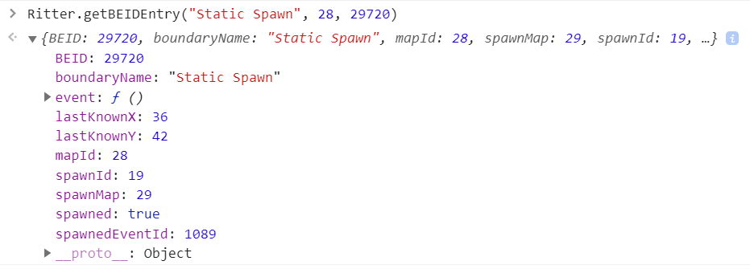
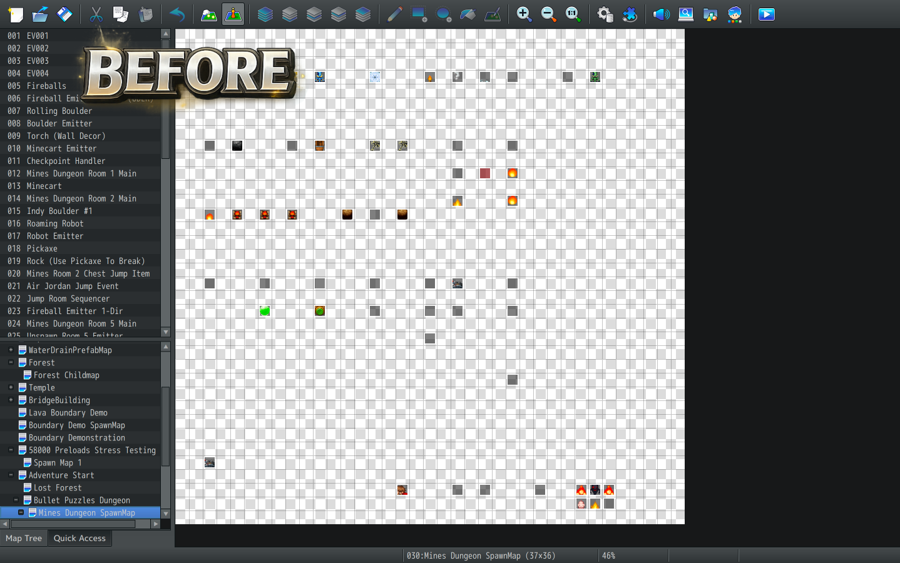
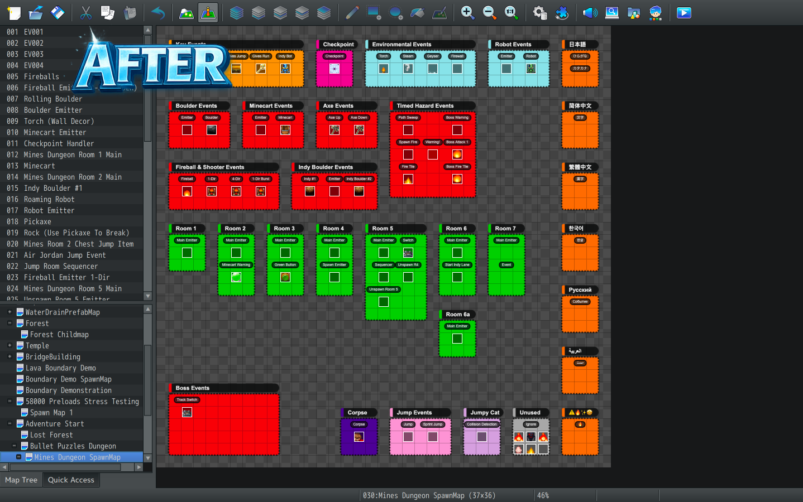

# Boundary System Best Practices Guide

The Ritter Boundary System makes it possible to create large, dynamic worlds by spawning events when they're needed and unspawning them when they're no longer nearby.

Whether you're building a world filled with NPCs, roaming enemies, gathering resources, or interactive objects, a few simple practices can help you get the most out of the system.

This guide covers seven recommendations for keeping your boundary systems organized, efficient, and reliable.

---

## 1. Keep Your Active Event Population Manageable

One of the biggest advantages of the Boundary System is that you don't need to keep every event in your world active at the same time.

For example, imagine a large world containing thousands of NPCs and creatures. Instead of loading all of them onto the map, you can use boundaries to spawn nearby events and unspawn those that are farther away.

Saved boundary events can retain their data while they're inactive, allowing them to return when needed.

**For the best results:**

- Use boundaries for events that don't need to remain active when the player is far away.
- Set reasonable limits on how many events can be active at once.
- Remember that active events still process their event pages, movement, and graphics.
- Keep important map controllers, cutscenes, and transfer events placed normally in the RPG Maker editor when that's more practical.

The ideal number of active events depends on your game's complexity and the hardware you're targeting. A map filled with simple objects may handle many more events than one filled with constantly moving enemies.

---

## 2. Choose Between Temporary and Saved Events

Not every event needs to remember its state after being unspawned.

Choosing the right type of event helps keep your world organized and avoids saving unnecessary information.

**Temporary Events**

Temporary events are useful for things that can be recreated without remembering their previous state.

Examples include:

- Random enemy encounters
- Temporary visual effects
- Repeatable environmental objects
- Creatures that don't need persistent identities

**Saved Boundary Events**

Saved boundary events are useful when something needs to remember its state after the player leaves.

Examples include:

- NPCs with changing dialogue or quest progress
- Treasure chests that should remain opened
- Resources that should remain depleted
- Persistent enemies or creatures
- Interactive objects that change over time

You can also [preload saved boundary events](../../Documentation/Boundary/preloadevents.html), allowing you to populate your world with persistent entities before the player encounters them.

**Tip:** Use temporary events for content that can be recreated freely, and saved events for content that needs to remember what happened to it.

**Tip 2:** If you're using external boundary saves, remember to include the additional boundary save files when backing up or transferring your game's saves. See [External Save Backups and Transfers](../../Documentation/Boundary/savedboundaryevents.html#external-save-backups-and-transfers) for details.

---

## 3. Use BEIDs to Track Persistent Events

When a saved boundary event is unspawned and later restored, its regular RPG Maker event ID may change.

This is normal. The Event Spawner recycles available runtime event IDs to keep spawning efficient.

To reliably identify persistent boundary events, the Boundary System uses **Boundary Event IDs (BEIDs)**.

A BEID allows you to find a saved boundary event even when it isn't currently active on the map.

When referencing a persistent boundary event, use these three pieces of information together:

- **Boundary Name:** The name of the boundary that owns the event.
- **Map ID:** The gameplay map containing the boundary event.
- **BEID:** The event's persistent Boundary Event ID.

Together, these identify the saved boundary event without relying on a runtime event ID that may change.

For example, if an NPC leaves the player's active area and is unspawned, you can use its BEID to locate its saved information later.

You can also use [Self Variables](../../Documentation/Boundary/selfvariables.html) to store information such as quest progress, resource depletion, or other persistent event data.

For detailed examples, see the [BEID Database Guide](../../Documentation/Boundary/beiddatabase.html).

---

## 4. Pair Spawn Boundaries with Unspawn Boundaries

For automatic event streaming, you'll generally want two boundaries working together:

- **Spawn Boundary:** Creates or restores events near the player.
- **Unspawn Boundary:** Removes events when they're no longer needed.

A common setup uses a smaller spawn boundary and a larger unspawn boundary, both following the player.

### Example Setup

Imagine creating the following boundaries:

| Setting | Spawn Boundary | Unspawn Boundary |
|---|---|---|
| Name | `spawn` | `unspawn` |
| Width | 17 | 25 |
| Height | 7 | 15 |
| Anchor | Player | Player |
| Purpose | Populate nearby areas | Remove distant events |

These dimensions are only examples. You can adjust them to suit your game's camera, map size, and gameplay.

As the player explores, the spawn boundary brings nearby events into the world. The larger unspawn boundary removes them once they reach its removal area.

This creates a buffer between spawning and unspawning so events don't immediately disappear when they leave the spawn boundary.

**Important:** Your unspawn boundary must be configured to target the correct spawn boundary name. Otherwise, it may not remove the events you expect.

### Set an Event Limit

Spawn boundaries also support a `maxEvents` setting that controls their automatic spawning capacity.

For example, setting `maxEvents` to `40` allows the boundary to maintain up to 40 automatically spawned events, subject to its normal spawning behavior.

Keep these points in mind:

- Set `maxEvents` to a positive number appropriate for your game.
- A value of `0` does not mean unlimited spawning.
- An event limit does not automatically unspawn events. You still need an unspawn boundary.
- Restoring saved boundary events through BEIDs can exceed the normal automatic spawning limit.

Start with a manageable population and increase it as you test your game's performance.

---

## 5. Initialize Your Starting Population

When using preloaded boundary events, you may want nearby events to appear immediately when the player enters the map.

The Boundary System provides `initBoundaryEvents` for this purpose.

After setting up your preloaded events and activating the appropriate spawn boundary, you can initialize the boundary's starting population.

This allows saved events within the relevant area to appear without waiting for the player to move far enough to trigger normal boundary streaming.

Initialization respects the boundary's normal capacity when processing stored events.

**When should you use it?**

- When starting a new game with preloaded NPCs or world objects.
- When you want the initial area populated before the player begins exploring.
- When setting up a world that already contains persistent boundary events.

You generally only need to perform this initial setup once for the intended starting population.

**Loading an existing save is different.** The Boundary System handles restoration of previously active saved events automatically. You shouldn't need to restart the game or repeatedly initialize boundaries just to make saved events appear.

For more information, see [Preloading Boundary Events](../../Documentation/Boundary/preloadevents.html).

---

## 6. Keep Your Spawn Maps and Saved Data Organized

Saved boundary events rely on their original event templates.

If you change or remove those templates, you may affect events that already exist in player saves.

To avoid problems:

- Keep spawn maps that are referenced by saved events.
- Avoid deleting or renumbering template events used by existing saves.
- Test changes to event pages, graphics, and behavior with older save files.
- Make backup copies of player saves before testing major updates.

### Organize Your Spawn Maps with Spawn Map Designer

As your project grows, keeping track of dozens or hundreds of event templates can become challenging.

**[Spawn Map Designer](https://notritter.itch.io/spawn-map-designer)** is a visual organization tool that helps you arrange and label your spawn maps using color-coded groups and event tags.

Instead of hunting through a scattered collection of templates, you can organize events by category, purpose, or gameplay area—making your spawn maps easier to navigate and maintain.

  

**[Check out Spawn Map Designer on itch.io](https://notritter.itch.io/spawn-map-designer)**

---

## 7. Test Your Boundaries in Different Situations

Boundaries are flexible, and the best configuration depends on how your game uses them.

Before finalizing your setup, test how your boundaries behave during normal gameplay.

### Things Worth Testing

- **Map edges:** Make sure boundaries behave correctly when they extend beyond the map.
- **Different event populations:** Test both lightly populated and heavily populated areas.
- **Player movement:** Walk through areas repeatedly to confirm events spawn and unspawn as expected.
- **Event limits:** Check that your configured population limits behave as intended.
- **Saved events:** Leave an area, return, and confirm persistent events restore correctly.
- **Save and load:** Save the game, close it, and load directly from Continue to verify restoration.
- **Other plugins:** Test compatibility with custom movement, visual effects, and other systems that interact with events.

### Visualizing Your Boundaries

The optional **Ritter_BoundaryVisualizer.js Developer Extension Plugin** can display your boundaries on-screen while testing.

This makes it easier to see their dimensions, positions, and how they move with the player or other events.

The visualizer is a development tool and isn't required for the Boundary System to function.

---

## Final Thoughts

The Boundary System is designed to help you create worlds that feel populated without requiring every event to remain active at once.

For the best results, focus on three things:

1. **Spawn events when they're needed.**
2. **Unspawn events when they're no longer needed.**
3. **Save events that need to remember their state.**

Combine those principles with sensible event limits, persistent BEIDs, and thorough testing, and you'll have a strong foundation for building large, dynamic RPG Maker worlds.
