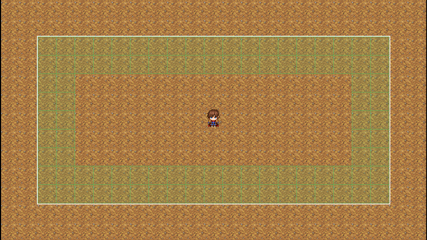

# Boundary System Introduction

*Boundaries visualized using the Ritter_BoundaryVisualizer.js Developer Extension Plugin*

* **2 Thickness "FillOn" Boundary** shown in **Green**
* **2 Thickness "UnspawnOn" Boundary** shown in **Red**

These examples are demonstrated on-screen, but boundaries can be created off-screen at any size.

---

## Overview

The **Ritter Boundary System** allows you to dynamically **spawn** and **unspawn** events based on:

* The player’s location
* The position of any event
* Any coordinate you choose on the map

Boundaries are created via simple script calls or plugin commands and are stored under a name you define. You can reference, move, resize, or modify them at any time. Create as many boundaries as needed, each with unique shapes, sizes, and behaviors.

---

## What a Boundary Is

A **boundary** is an invisible zone the engine responds to. As its anchor moves, the boundary moves with it, automatically handling event population inside it.

You can anchor a boundary to:

* **The player**
* **Any event**
* **A static (x, y) location**

This gives you precise control over when events should appear or be removed from the map.

---

## What Boundaries Are Used For

Because boundaries can spawn **any type of event**, they enable dynamic populations with controlled live-event counts. Common uses include:

* Spawning enemies just outside player view for endless encounters
* Loading NPCs, creatures, or gathering nodes as the player approaches
* Adding environmental objects such as debris, interactables, or obstacles
* Creating temporary triggers or transfer points
* Building “living” maps full of dynamic activity
* Preloading events into the Boundary Saved Events Database for fine-grained control

Consider streaming events that do not need to run continuously. Keep essential controllers or transfers editor-placed when that makes their lifecycle clearer.

Integrations must handle removal, recycling, and restoration. Use full BEID tuples for persistent references and review the [developer guide](../../compatibility.html).

Performance depends on live pages, movement, graphics, plugin integrations, and hardware as well as event count.

---

## Boundary Types

Below are the primary boundary types used to control event spawning.

### **Fill On - Spawn Boundary**

* **Type:** `FillOn`
* **Width:** 17
* **Height:** 7
* **Thickness:** 1

Behavior:

* Attempts to spawn events on every tile that is **on the boundary edge**.
* Restores any saved events found on those tiles.
* Spawns events that match your BoundaryEventSetup rules (legacy mode).
* **Thickness** extends the boundary outward.

---

### **Fill In - Spawn Boundary**

* **Type:** `FillIn`
* **Width:** 17
* **Height:** 7
* **Thickness:** 1

Behavior:

* Attempts to spawn events on every tile **inside** the boundary.
* Restores saved events on checked tiles.
* Spawns events that meet BoundaryEventSetup conditions.
* Thickness extends outward as shown in later examples.

---

### **Spawn On - Spawn Boundary**

* **Type:** `SpawnOn`
* **Width:** 17
* **Height:** 7
* **Thickness:** 2

Behavior:

* Attempts to spawn one event on a random tile that is **on the boundary edge**.
* Processes stored entries owned by this boundary on its edge while capacity permits; saved restoration can restore more than one event.
* Spawns events that match your BoundaryEventSetup rules (legacy mode).
* **Thickness** extends the boundary outward.

---

## Automatic Recycling & Event Limits

Each boundary can have a **maximum number of events** it’s allowed to keep active.

For example, a boundary with a limit of **40** will:

* Spawn events until it reaches 40 active
* Unspawn events automatically as they leave the unspawn boundary
* Recycle newly freed event slots for future spawns

This controls automatic live capacity when a matching outer unspawn handler is configured. A cap alone does not remove events outside the spawn boundary. Explicit BEID restoration can exceed automatic capacity; profile the intended configuration.

---

## How Boundaries Fit Into Your Workflow

The Boundary System integrates tightly with the Event Spawner:

With a simple setup; such as a **spawn boundary** just outside the player’s screen and an **unspawn boundary** a bit further you gain fully automated event streaming:

* Automatic spawning & unspawning based on player movement
* Persistent events that restore saved data
* Clean population cycling
* Scalable systems for open worlds
* Preloaded events via XY or RegionId

Streaming avoids active simulation for dormant entities. Stored records still consume memory and persistence work.

Choose the active cap for your project. The release demonstration contains **60,801 persistent entities** with approximately **650 live simultaneously** under its tested configuration; these are different counts, not a fixed limit or a universal performance result.

Start with the [boundary setup examples](../../Documentation/Boundary/scriptcalls.html), then [preload persistent entities](../../Documentation/Boundary/preloadevents.html).

---

## A Simple Tool with Massive Impact

The Ritter Boundary System delivers:

* Reduced active-event work through streaming
* Larger, more dynamic maps
* Cleaner event organization
* Automated event recycling
* Scalable world structures

It keeps your event count low while allowing your world to feel full of life.
