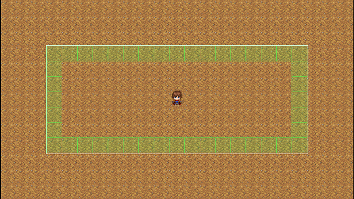
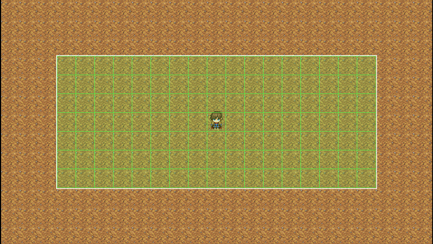

# Boundary System Introduction


*Boundaries visualized using the Ritter_BoundaryVisualizer.js Developer Extension Plugin.*

- **Green:** A `FillOn` boundary with a thickness of 2.
- **Red:** An `UnspawnOn` boundary with a thickness of 2.

These examples show boundaries on-screen, but boundaries can also extend beyond the visible screen and can be created in a variety of sizes.

---

## Overview

The **Ritter Boundary System** works alongside the Ultimate Event Spawner to automatically spawn and unspawn events based on their location within your game world.

Boundaries can follow:

- **The player**, moving as the player explores.
- **Any event**, following that event's position.
- **A fixed map location**, remaining at coordinates you choose.

Each boundary has a name you assign, allowing you to reference, move, resize, or modify it through script calls and plugin commands.

You can create multiple boundaries with different sizes, shapes, and behaviors to control when and where events appear.

For example, you could create a boundary around the player that spawns nearby NPCs and creatures, paired with a larger boundary that removes those events as the player moves away.

The result is a world that can feel populated and active without requiring every event to remain loaded at once.

---

## What Is a Boundary?

A **boundary** is an area of your map that the Boundary System uses to determine where events should spawn or unspawn.

Boundaries can operate along their **edges** or across their **interior**.

They can also move automatically when attached to the player or another event.

For example, imagine a boundary surrounding the player:

- As the player moves, the boundary moves with them.
- New areas enter the boundary, allowing events to spawn.
- Areas left behind can be handled by an unspawn boundary.
- Saved events can be restored when the player returns.

This allows you to build dynamic event populations that respond to exploration.

### Boundary Size and Thickness

Boundaries have configurable dimensions, including width, height, and thickness.

- **Width** determines how wide the boundary is.
- **Height** determines how tall the boundary is.
- **Thickness** extends the boundary outward, allowing its edge to cover additional tiles.

For example, a boundary with a width of 17, height of 7, and thickness of 2 covers a wider edge than the same boundary with a thickness of 1.

The illustrations below demonstrate how different boundary types use these settings.

---

## The Six Boundary Types

The Boundary System provides six primary behaviors.

| Boundary Type | What It Does |
|---|---|
| `SpawnOn` | Spawns one event at a location along the boundary's edge. |
| `SpawnIn` | Spawns one event at a location inside the boundary. |
| `FillOn` | Attempts to spawn events on every eligible tile along the boundary's edge. |
| `FillIn` | Attempts to spawn events on every eligible tile inside the boundary. |
| `UnspawnOn` | Unspawns boundary events located along the boundary's edge. |
| `UnspawnIn` | Unspawns boundary events located inside the boundary. |

**On** means the boundary's edge.

**In** means the area inside the boundary.

**Spawn** places an event at a selected location, while **Fill** attempts to populate every eligible tile in the selected area.

**Unspawn** removes matching boundary events from the active map.

### SpawnOn - Spawn Along the Edge

`SpawnOn` attempts to spawn one event at a random eligible location along the boundary's edge.

This is useful for spawning enemies, creatures, or other events around the player without filling every tile.

**Example Script Call:**

```js
const spawnMapId = 2;
const spawnEventId = 1;
const regions = [1, 2, 3];
const boundaryName = "spawn";

Ritter.spawnEventOnBoundary(
    spawnMapId,
    spawnEventId,
    regions,
    boundaryName
);
```

This attempts to spawn event 1 from spawn map 2 along the edge of the boundary named `"spawn"`, using the specified region IDs.

### SpawnIn - Spawn Inside the Boundary

`SpawnIn` attempts to spawn one event at a random eligible location inside the boundary.

This is useful when you want to place an event somewhere within an area rather than specifically along its edge.

**Example Script Call:**

```js
const spawnMapId = 2;
const spawnEventId = 1;
const regions = [1, 2, 3];
const boundaryName = "spawn";

Ritter.spawnEventInBoundary(
    spawnMapId,
    spawnEventId,
    regions,
    boundaryName
);
```

This attempts to spawn the selected event inside the boundary named `"spawn"`.

### FillOn - Fill the Boundary Edge



**Example Dimensions:**

- Width: 17
- Height: 7
- Thickness: 1

`FillOn` attempts to spawn an event on every eligible tile along the boundary's edge.

This is useful for creating groups of objects or events around an area.

For example, you could use it to populate the edge of a boundary with obstacles, environmental objects, or other event-based content.

**Example Script Call:**

```js
const spawnMapId = 2;
const spawnEventId = 1;
const regions = [1, 2, 3];
const boundaryName = "spawn";

Ritter.spawnFillOnBoundary(
    spawnMapId,
    spawnEventId,
    regions,
    boundaryName
);
```

### FillIn - Fill the Boundary Interior



**Example Dimensions:**

- Width: 17
- Height: 7
- Thickness: 1

`FillIn` attempts to spawn events on every eligible tile inside the boundary.

This is useful when you want to populate an entire area rather than selecting a single spawn location.

For example, you could fill an area with environmental objects or other event-based content.

**Example Script Call:**

```js
const spawnMapId = 2;
const spawnEventId = 1;
const regions = [1, 2, 3];
const boundaryName = "spawn";

Ritter.spawnFillInBoundary(
    spawnMapId,
    spawnEventId,
    regions,
    boundaryName
);
```

### UnspawnOn - Unspawn Along the Edge

`UnspawnOn` removes boundary events located along the edge of the specified boundary.

This is particularly useful for automatically removing events as the player moves away from them.

For example, you could place an unspawn boundary farther away from the player than the spawn boundary. As events reach its edge, they can be unspawned.

**Example Script Call:**

```js
const boundaryName = "unspawn";

Ritter.unspawnEventOnBoundary(boundaryName);
```

This unspawns matching boundary events along the edge of the boundary named `"unspawn"`.

### UnspawnIn - Unspawn Inside the Boundary

`UnspawnIn` removes boundary events located inside the specified boundary.

Unlike `UnspawnOn`, which checks the edge, this operates across the boundary's interior.

This is useful when you want to clear boundary events from an entire area.

**Example Script Call:**

```js
const boundaryName = "unspawn";

Ritter.unspawnEventInBoundary(boundaryName);
```

This unspawns matching boundary events inside the boundary named `"unspawn"`.

---

## What Can You Build with Boundaries?

Boundaries can work with many different types of RPG Maker events.

Some possibilities include:

- **Dynamic enemy encounters:** Spawn enemies around the player as they explore.
- **Persistent NPC populations:** Load NPCs when nearby and restore their saved state when returning.
- **Wildlife and creatures:** Populate forests, fields, and other environments dynamically.
- **Gathering resources:** Spawn plants, minerals, and other collectible objects.
- **Environmental details:** Add debris, obstacles, decorations, and interactive objects.
- **Large explorable worlds:** Manage event populations across areas without keeping every event active simultaneously.

You can also preload persistent events into the Boundary Saved Events Database, allowing your world to contain saved entities that are restored as needed.

---

## Automatic Event Recycling and Population Limits

The Boundary System works with the Event Spawner's automatic event recycling.

When events are unspawned, their available runtime resources can be reused for future spawns.

You can also configure limits on how many events a boundary spawns automatically.

For example, a spawn boundary with a maximum population of **40 events** can be paired with an outer unspawn boundary.

As the player explores:

1. The spawn boundary creates events until its configured limit is reached.
2. The unspawn boundary removes events that move outside the desired active area.
3. Freed event slots become available for recycling.
4. The spawn boundary can continue populating new areas as capacity becomes available.

This helps maintain an active population around the player without endlessly increasing the number of live events.

Saved boundary events can also be restored independently of ordinary automatic spawning limits.

For more information, see the [Event Recycling Guide](../../Guides/eventrecycling.html).

---

## Creating a Living World

One of the most powerful uses of the Boundary System is **event streaming**.

Instead of keeping every NPC, creature, or object active across an entire world, you can load events when they're needed and unspawn them when they're no longer nearby.

A common setup uses two boundaries that follow the player:

- **Spawn Boundary:** A smaller boundary that spawns or restores nearby events.
- **Unspawn Boundary:** A larger boundary that removes events once they're sufficiently far away.

Because the unspawn boundary extends farther than the spawn boundary, events can remain active as the player moves around without immediately disappearing when they leave the spawn area.

When saved boundary events are unspawned, their persistent data can be retained and restored when the player returns.

### Large-Scale Demonstration

The v2.1 demonstration features a world containing:

- **60,801 persistent boundary events**
- Approximately **650 simultaneously active events** in the tested configuration

The remaining events are stored until they're needed again.

This demonstrates how the Boundary System can manage large persistent populations without requiring every event to be active simultaneously.

Actual performance depends on your project's event logic, graphics, other plugins, and hardware.

---

## Getting Started

Ready to create your first boundary?

Start with the [Boundary Script Calls](../../Documentation/Boundary/scriptcalls.html) guide to learn how to create, position, and configure boundaries.

Once you're comfortable with the basics, explore [Preloading Boundary Events](../../Documentation/Boundary/preloadevents.html) to learn how to populate your world with persistent events.

---

## A Simple Tool with Massive Impact

The Ritter Boundary System gives you the tools to build larger, more dynamic RPG Maker worlds through:

- Automatic event spawning and unspawning
- Player-following, event-following, and fixed-position boundaries
- Six flexible boundary behaviors
- Configurable event population limits
- Automatic event recycling
- Persistent event populations
- Event streaming for large worlds

**Build a world full of life without keeping the entire world running at once.**
