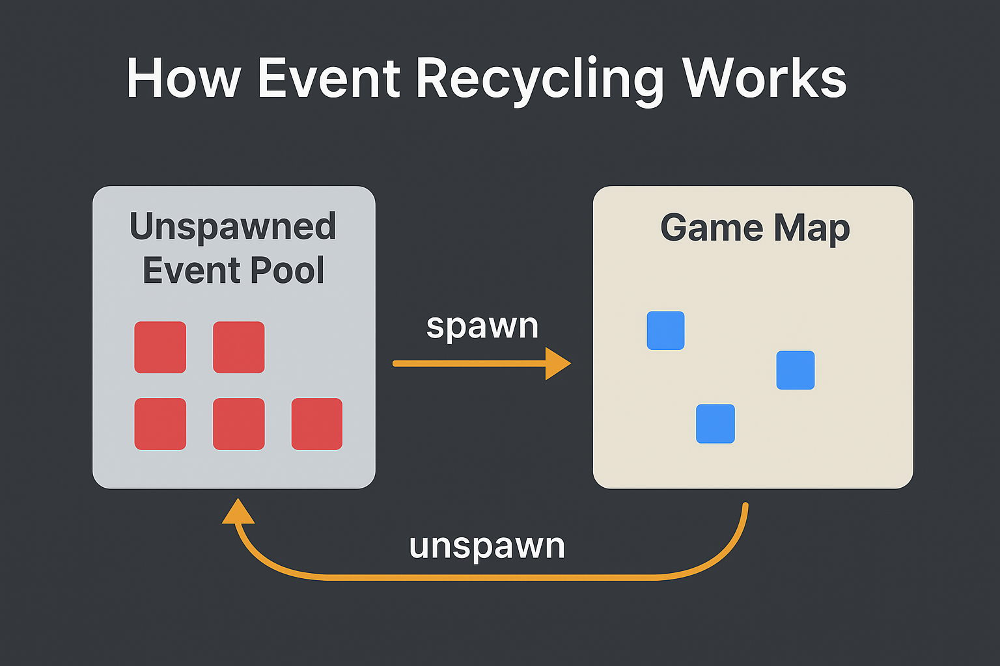

# Event Recycling

The Ritter Ultimate Event Spawner includes an automatic event recycling system designed to make repeated spawning and unspawning more efficient.

Instead of continually creating new event objects and assigning higher event IDs, the Event Spawner can reuse previously unspawned events and their available event IDs.

This is especially useful for games with large numbers of enemies, NPCs, objects, or other events that appear and disappear throughout gameplay.

**Event recycling happens automatically.** You don't need to enable it or manage a recycling pool yourself.

## How Event Recycling Works

Imagine your game regularly spawns enemies as the player explores.

Without event recycling, repeatedly creating and removing enemies could cause the event list to grow unnecessarily over time.

With event recycling:

1. An enemy is spawned onto the map.
2. The enemy is defeated or is no longer needed.
3. The Event Spawner unspawns the enemy.
4. The event and its available ID can be reused for another spawned enemy.

The Event Spawner also supports reusing character sprites, helping reduce unnecessary object creation during repeated spawning.

This allows your game to continuously spawn and unspawn events without requiring a new event ID for every spawn.

## Recycling and Saved Events

Event recycling works alongside the Event Spawner's saving systems.

**Temporary Events:** When a temporary event is unspawned, its event ID becomes available for reuse.

**Saved Events:** Saved events retain their state and reserve their event IDs until they are permanently removed.

**Saved Boundary Events:** These events use persistent Boundary Event IDs (BEIDs) to maintain their identities, even if their runtime event IDs change when they are restored.

This means you can recycle events while still maintaining persistent NPCs, objects, and other saved entities.

For more information, see [Saved Events](../Documentation/savedevents.html) and [Saved Boundary Events](../Documentation/Boundary/savedboundaryevents.html).

## Large-Scale Event Management

Event recycling becomes particularly valuable when combined with the Boundary System.

Boundaries allow events to spawn as the player approaches and unspawn when they are no longer needed.

Together, these systems make it possible to maintain large persistent populations without keeping every event active at the same time.

For example, the v2.1 demonstration includes:

- **60,801 persistent boundary events** stored in the world.
- Approximately **650 events active simultaneously** in the tested configuration.
- The remaining events stored until needed.

The recycling stress test also repeatedly spawns and unspawns events across **250 designated map tiles per cycle**.

These demonstrations show how recycling and boundary streaming can support large-scale event systems. Actual performance depends on your project's event logic, graphics, plugins, and target hardware.

## Best Practices

- **Unspawn events when they're no longer needed.** This allows their available runtime resources to be reused.
- **Use temporary events for disposable content.** Enemies, effects, and other events that don't need to remember their state are good candidates.
- **Save events that need persistence.** Use saved events or saved boundary events for NPCs, treasure chests, and other objects that should remember their state.
- **Use boundaries for larger populations.** Spawn and unspawn events based on the player's location instead of keeping everything active.
- **Test with your actual game.** Event pages, movement, graphics, and other plugins still affect performance.

## Summary

Event recycling helps the Ritter Ultimate Event Spawner efficiently reuse events during repeated spawning and unspawning.

Combined with saved events and boundary streaming, it provides a foundation for creating larger, more dynamic RPG Maker worlds without unnecessarily growing the active event list.
